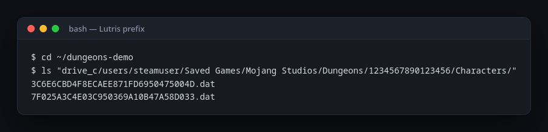
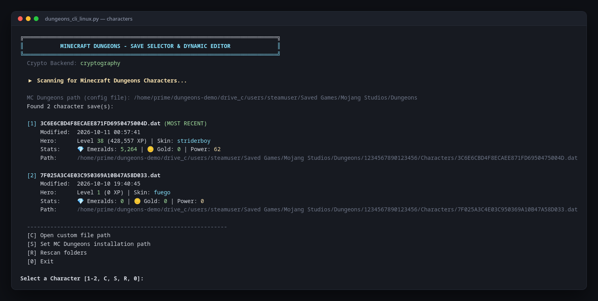
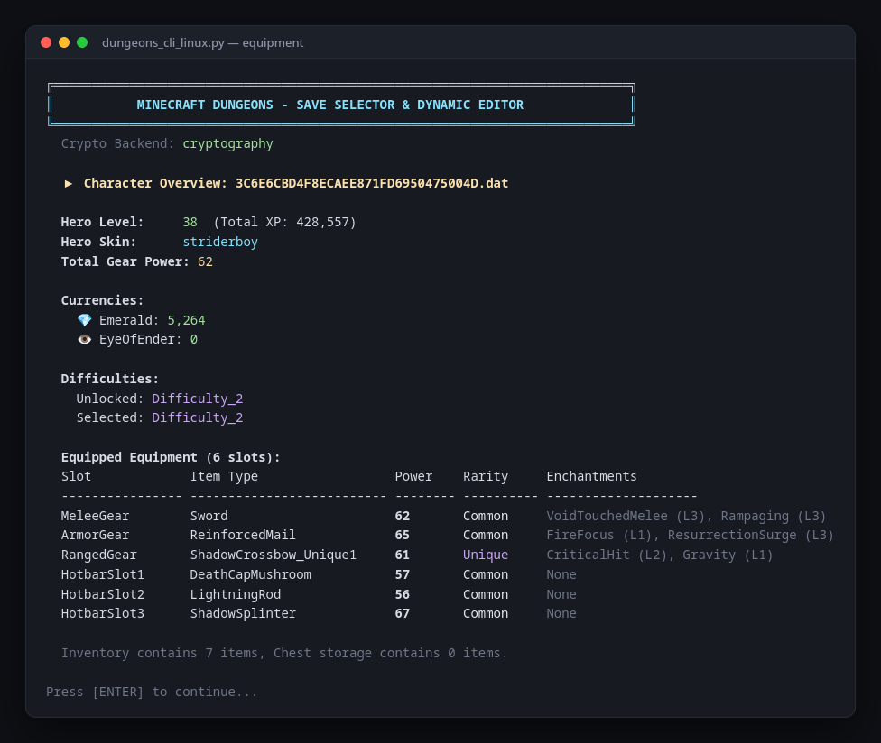
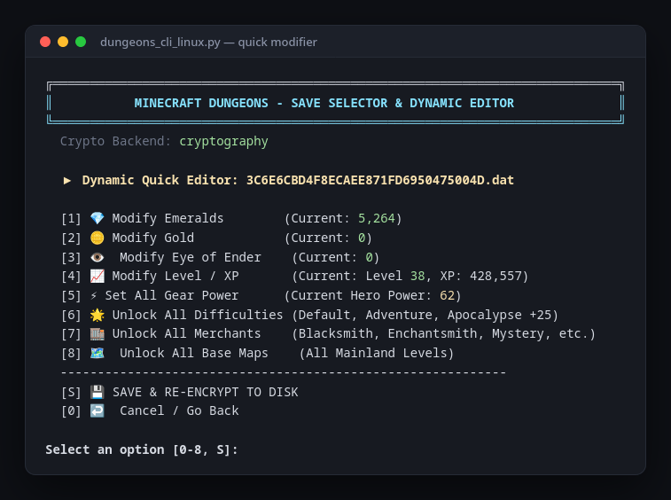

# Casually Hacking Minecraft Dungeons

## TL;DR

Minecraft Dungeons `.dat` saves are an 8-byte `D001` header + AES-256-ECB-encrypted JSON, padded to 16-byte blocks — and the key ships with the game, so it's a format puzzle, not a crypto break.

Decrypt → edit → re-encrypt round-trips byte-identically, and the game accepts the result — a small CLI does exactly that, on Windows and Linux.

## I just wanted to play my game on Linux

I didn't set out to reverse-engineer a file format. I wanted to play Minecraft Dungeons on Linux.

I had the game on Windows — characters, gear, progress — so I set up Lutris and a Wine prefix, installed it, hit Play, and got an empty character select screen. Zero heroes. Not the welcome I expected.

## The characters that never arrived

Cloud sync was on, and my Microsoft account was signed in on the Windows machine, so I assumed that was enough. It wasn't.

A fresh Wine prefix starts from nothing, and no amount of relaunching brought the characters over. The search results were blunt: Minecraft Dungeons keeps its saves on local disk. Not in the cloud — on the machine, in a folder.

That folder looks like this:

```text
.../Saved Games/Mojang Studios/Dungeons/<account-id>/Characters/
```

Inside it there is one `.dat` file per character (`<char-id>.dat`). The `<account-id>` folder belongs to the Microsoft account, and the `savefile.dat` in the same directory is the account's own file — not a character.

For players, two consequences worth knowing:

- Moving machines, reinstalling, or starting a new Wine prefix means carrying your characters over by hand.
- Your progress is a small set of files. You can back them up yourself — and you probably should.



## Inside a .dat

The first thing I did was open a save in a hex editor. The start of the file is readable:

```text
44 30 30 31 00 00 00 00     "D001" + four null bytes
```

After those 8 bytes, nothing. No strings, no JSON, no hints — just high-entropy bytes. That is what encryption looks like.

It turned out to be AES-256-ECB. The plaintext is UTF-8 JSON, padded so its length is a multiple of the 16-byte block size, and the key — which was recovered — lives in the codec.

The test that convinced me: decrypt a save and re-encrypt it without changing anything, and the result is byte-identical to the original file. If the header, cipher mode, or padding had been wrong anywhere, the bytes would not match. They matched, end to end — that's how I knew I had it right.

The decrypted JSON (format version 3) is clean and well-organised:

- Hero XP — and the game's own level formula: `total XP for level L = 100 × (L − 1) × (3L − 1)`
- Currencies: `Emerald`, `Gold`, `EyeOfEnder`
- Difficulties and threat levels
- Items, each tagged with an `equipmentSlot`: `MeleeGear`, `RangedGear`, `ArmorGear`, `HotbarSlot1`–`HotbarSlot3`
- Backpack, storage chest, camp-merchant progression, map progress, cosmetics

One quirk worth a line: item power is stored as an internal float, while the game displays `floor((raw − 1) × 10) + 1`. Editing raw values without knowing that formula gives you numbers the game will happily show as something else.

## The reverse-engineering, honestly

I'll say this plainly: I used AI assistance for this, and it was not one prompt.

The work was a loop — form a hypothesis about the format, test it against a real save, verify at byte level, repeat. AI compressed the tedious parts: writing the AES plumbing, generating candidate parsers, spotting structure in the JSON. Every step that mattered was checked against actual files: the header bytes, the padding behaviour, and finally the byte-identical round-trip.

## Building the tool

Once the JSON was readable and writable, the interesting part was done — and the useful part began. Decrypting a file by hand is a novelty; a tool that makes editing safe and boring is worth sharing.

The tool is a CLI with four core flows:

- **Character list** — every save on the machine with level, XP, skin, emeralds, gold, gear power and last-modified time.
- **Gear view** — equipped melee, ranged, armor and artifacts with in-game power, rarity and enchantments; backpack and storage chest counted separately.
- **Dynamic modifier** — emeralds, gold, Eyes of Ender, level/XP, gear power, unlock all difficulties (up to Apocalypse +25 / Threat 25), camp merchants and base maps.
- **Live editor** — export the decrypted JSON, edit it in your own editor (Notepad or VS Code on Windows, `$EDITOR` or the desktop default on Linux), press Enter, and it re-encrypts straight back into the save.







On top of that: JSON export/import, and a backup manager to list and restore earlier versions.

The safety bits:

- Before any write, the tool creates a `.bak` of the original and a timestamped copy in `backups/`.
- If the JSON is invalid, it refuses to write — a corrupted save is worse than no edit.
- Nothing is written until the new content parses.

And one practical choice: **zero required dependencies**. The codec ships a pure-Python AES-256 engine as a fallback and uses `cryptography` (or `pycryptodome`) automatically when installed. Anyone with Python 3.8+ can run it — no `pip install`, no toolchain, on either OS.

## Windows and Linux

Same format, same codec, two editions:

- **Windows**: `windows/dungeons_cli.py`, launched with `windows/run.bat`, documented in `windows/README.md`
- **Linux**: `linux/dungeons_cli_linux.py`, launched with `linux/run.sh`, documented in `linux/README.md`
- **Shared**: `common/dungeons_codec.py` — the decrypt/encrypt logic and backup handling

Because the `.dat` format is identical on both systems, moving a character is a file copy: close the game, copy `<char-id>.dat` into the `.../Characters/` folder on the other side.

The Linux edition needed real work around paths. A Wine-family install lives inside a prefix, and the tool has to find it:

- The path can be set in four ways: a constant at the top of the script, the `DUNGEONSREV_PATH` environment variable, the `[S]` menu (persisted to `dungeonsrev_config.json`), or auto-detection.
- Auto-detection covers Lutris, Heroic, plain Wine and Bottles (Flatpak) setups.
- Whatever you paste — a prefix, the game folder, `drive_c`, the `Dungeons` folder, or a `<id>/Characters` folder — it resolves to the right location.

```text
Windows: C:\Users\<user>\Saved Games\Mojang Studios\Dungeons\<account-id>\Characters\
Linux:   ~/Games/<game>/drive_c/users/<user>/Saved Games/Mojang Studios/Dungeons/<account-id>/Characters/
```

## Using it

```bash
git clone https://gitlab.com/prime-cybersec/mcdungeons-charactermod.git
cd mcdungeons-charactermod
# Windows: windows\run.bat    |    Linux: linux/run.sh
# or manually: python3 linux/dungeons_cli_linux.py
# first run: confirm the auto-detected path (or press [S] to set it)
```

If you only want to convert files, the codec works standalone:

```bash
python3 common/dungeons_codec.py -d <save>.dat out.json    # decrypt to JSON
python3 common/dungeons_codec.py -e out.json <save>.dat    # re-encrypt back
```

Full guides live in the repo: `windows/README.md` and `linux/README.md`.

One actual rule: close the game before editing a save.

## What I learned

- The saves were never lost. They were local files the whole time — "cloud sync" was my assumption, not the game's behaviour.
- An encrypted container is usually less scary than it looks: a header, a standard cipher, a JSON body. The hard part is not cleverness, it is verification.
- AI compressed the boring parts of the work. The byte-identical round-trip is what turned a plausible theory into a format I could safely write to.
- Cross-platform is mostly paths and launchers — the crypto was identical on both systems.
- Backups and validation are cheap. A save editor that corrupts saves is worse than no save editor.

I built this because my characters didn't show up on Linux. If yours don't either — now you know where they are.

---

*Not an official Minecraft product. Not approved by or associated with Mojang or Microsoft.*
